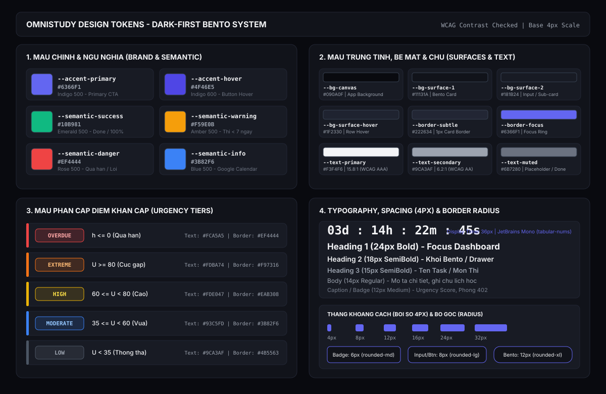

# Design System & UI Specification - OmniStudy

Tài liệu này định nghĩa hệ thống quy chuẩn thiết kế giao diện (Design System), bảng Tokens chuẩn hóa, kiến trúc bố cục, đặc tả chuyển động và các nguyên tắc kỹ thuật bắt buộc cho **OmniStudy** theo phong cách **Light-First Cozy Woodland Bento** (lấy cảm hứng từ thiên nhiên rừng thông và mặt hồ tĩnh lặng kiểu Sherwood Island: sử dụng họa tiết lá cây và cây thông tối giản, tuyệt đối không dùng nhân vật game hay biểu tượng emoji). Quy chuẩn này nhằm mang lại trải nghiệm học tập dịu mắt, ấm áp và ngăn chặn triệt để hiện tượng **AI Slop** khi lập trình giao diện.

---

## 1. Triết Lý Thiết Kế (Design Philosophy)

1. **Light-First Cozy Woodland Bento Grid:** Sử dụng nền giấy ấm **Warm Parchment** (`#ECE7D8`), hệ thẻ kem **Warm Cream** (`#FAF6EC`) với viền mảnh `1px solid #DDD6C3`, kết hợp thanh điều hướng trái **Deep Forest Pine** (`#2F4231`) và banner cảnh quan rừng thông tối giản. Cách phối màu tự nhiên giúp sinh viên duy trì sự tập trung cao trong nhiều giờ mà không bị chói mắt hay nặng nề.
2. **Calm Visual Urgency Hierarchy:** Cảnh báo mức độ khẩn cấp bằng chấm tròn trạng thái (`status dot`), đường viền mảnh `1px` và nhãn `pill` hữu cơ dịu mắt theo 5 cấp độ. Tuyệt đối không dùng đường viền trái neon dày (`3px`) hay màu sắc rực chói gây nhiễu thị giác.
3. **Tabular Digits First:** Toàn bộ đồng hồ đếm ngược, điểm khẩn cấp (`UrgencyScore`), tỷ lệ sẵn sàng (`% Readiness`), tổng giờ trong ngày (`8.5h`), khung giờ 24h (`08:30`) và bộ đếm công việc bắt buộc dùng `--font-mono` kèm `font-variant-numeric: tabular-nums` để triệt tiêu rung giật bố cục (Layout Shift).
4. **State-Complete & Motion-Respectful UI:** Mọi thành phần hiển thị dữ liệu bắt buộc hoàn thiện đủ 3 trạng thái biên (**Warm Shimmer Skeleton**, **Empty State**, **Error Alert**), chuyển động có chủ đích và tôn trọng tuyệt đối `@media (prefers-reduced-motion: reduce)`.

---

## 2. Bảng Tokens Thiết Kế (Design Tokens)



### 2.1. Hệ Màu Nền, Thanh Điều Hướng & Bề Mặt (Surfaces & Sidebar)

| Màu mẫu | CSS Variable | Mã Hex | Mục đích sử dụng |
| :---: | :--- | :--- | :--- |
|  | `--bg-canvas` | `#ECE7D8` | Nền tổng thể toàn trang (Warm Parchment Canvas) |
|  | `--bg-sidebar` | `#2F4231` | Nền thanh điều hướng trái `ForestSidebar` cố định `248px` (Deep Forest Pine) |
| — | `--bg-sidebar-hover` | `#3B513D` | Trạng thái di chuột (Hover) của mục điều hướng trên `ForestSidebar` |
| — | `--bg-sidebar-card` | `#4A5F44` | Nền thẻ mẹo học tập / tóm tắt nhanh bên trong `ForestSidebar` |
| — | `--bg-wood-sign` | `#9B6B43` | Nền biển gỗ mục tiêu trên sidebar (viền `#7A5130`, chữ `#FDF9F0`) |
|  | `--bg-surface-1` | `#FAF6EC` | Nền các thẻ Bento Grid chính, `ExamPrepDrawer` và Modal Dialog (Warm Cream) |
|  | `--bg-surface-2` | `#F1ECDD` | Nền thẻ Task con, ô nhập liệu form, nền khung Shimmer Skeleton (Soft Oat) |
|  | `--bg-surface-hover` | `#E7E0CC` | Trạng thái di chuột (Hover) của dòng dữ liệu, thẻ con và nút phụ |
|  | `--border-subtle` | `#DDD6C3` | Đường viền mảnh `1px solid` phân tách giữa các khối Bento và thẻ con |
|  | `--border-focus` | `#4F7043` | Viền khi Focus bàn phím vào ô nhập liệu, nút bấm hoặc phần tử đang chọn |

### 2.2. Hệ Màu Chữ & Tương Phản (Typography Colors)

| Màu mẫu | CSS Variable | Mã Hex | Mục đích sử dụng |
| :---: | :--- | :--- | :--- |
|  | `--text-primary` | `#283629` | Tiêu đề chính, tên môn thi, số giờ đếm ngược, nội dung chính trên nền sáng |
|  | `--text-secondary` | `#546353` | Mô tả phụ, tên phòng thi, nhãn thời gian, ghi chú |
|  | `--text-muted` | `#626F5F` | Văn bản gợi ý (Placeholder), công việc đã gạch ngang hoàn thành |
| — | `--text-on-sidebar` | `#F4EFE2` | Chữ chính trên nền thanh điều hướng `ForestSidebar` (`#2F4231`) |
| — | `--text-on-sidebar-muted` | `#C6D1BF` | Nhãn nhóm điều hướng và chữ phụ trên nền `ForestSidebar` |

### 2.3. Hệ Màu Thương Hiệu & Ngữ Nghĩa (Brand & Semantic Colors)

| Màu mẫu | Token Name | Mã Hex | Ý nghĩa & Ứng dụng |
| :---: | :--- | :--- | :--- |
|  | `--accent-primary` | `#4F7043` | Nút hành động chính (CTA: `+ Thêm Lịch Thi`, `Lưu công việc`, `Tạo lộ trình`) |
|  | `--accent-hover` | `#3F5B35` | Trạng thái Hover của nút hành động chính |
|  | `--semantic-success` | `#2E7D52` | Hoàn thành công việc, thanh `% Readiness` (nền nhãn `--semantic-success-bg`: `#E3F2EA`) |
|  | `--semantic-warning` | `#B87A1E` | Cảnh báo kỳ thi còn dưới 7 ngày (chữ `#8A580F`, nền `#FBF1DC`) |
|  | `--semantic-danger` | `#B94435` | Kỳ thi dưới 24h, quá hạn, lỗi validation form, Error Alert (chữ `#9A3326`, nền `#FBEAE7`) |
|  | `--semantic-info` | `#3A6F88` | Sự kiện đồng bộ từ Google Calendar API v3 (chữ `#2B566B`, nền `#E5F1F6`) |

### 2.4. Màu Phân Cấp Điểm Khẩn Cấp Động (Dynamic Urgency Tier Colors)

Mỗi thẻ công việc sử dụng **viền mảnh `1px solid`**, **chấm tròn trạng thái (`status dot`)** cùng màu chữ cấp bậc và **nhãn pill hữu cơ (`rounded-full`)**; tuyệt đối không dùng viền trái neon dày (`3px solid`).

| Màu mẫu (Chữ / Viền) | Phân cấp | Tiêu chí | Màu chữ & Dot | Màu nền Pill | Viền thẻ (`1px solid`) |
| :---: | :--- | :--- | :--- | :--- | :--- |
|   | `OVERDUE` | $h \le 0$ (Quá hạn) | `#9A3326` | `#F9DFDA` | `1px solid #D97C6E` (nhịp thở nhẹ) |
|   | `EXTREME` | $U \ge 80$ (Cực gấp) | `#9E4718` | `#FBE6D4` | `1px solid #E09866` |
|   | `HIGH` | $60 \le U < 80$ (Ưu tiên cao) | `#8A580F` | `#FBF0D6` | `1px solid #D9AE59` |
|   | `MODERATE` | $35 \le U < 60$ (Vừa phải) | `#2B566B` | `#E4F0F5` | `1px solid #7FAAC0` |
|   | `LOW` | $U < 35$ (Thong thả) | `#546353` | `#EAE6D9` | `1px solid #C9C2AE` |

---

## 3. Hệ Thống Kiểu Chữ (Typography System)

- **Font tiêu đề & lời chào (`--font-display`):** `'Fraunces', 'Lora', Georgia, serif`
- **Font chữ giao diện chính (`--font-sans`):** `'Plus Jakarta Sans', 'Inter', -apple-system, sans-serif`
- **Font chữ số liệu & đếm ngược (`--font-mono`):** `'JetBrains Mono', monospace`
- **Quy tắc bắt buộc:** Mọi phần tử hiển thị con số (đồng hồ đếm ngược 4 cột, điểm số $U$, tỷ lệ `% Readiness`, số giờ làm việc như `8.5h`, thời gian 24h `08:30`, số lượng task) **bắt buộc** khai báo:
  ```css
  font-family: var(--font-mono);
  font-variant-numeric: tabular-nums;
  ```

| Cấp bậc chữ | Font Family | Kích thước (rem / px) | Độ đậm (Weight) | Line-height | Ứng dụng |
| :--- | :--- | :--- | :--- | :--- | :--- |
| `Display Banner` | `--font-display` | `1.75rem` (`28px`) | `600` (SemiBold) | `1.2` | Lời chào trong `ScenicHeaderBanner`, tiêu đề trang chính |
| `Display Timer` | `--font-mono` | `2rem` (`32px`) | `700` (Bold) | `1.1` | Đồng hồ đếm ngược 4 cột trên 1 hàng ngang (`tabular-nums`) |
| `Heading 1` | `--font-display` | `1.375rem` (`22px`) | `600` (SemiBold) | `1.25` | Tiêu đề màn Lịch tuần, màn Lịch thi, Modal |
| `Heading 2` | `--font-sans` | `1.0625rem` (`17px`) | `700` (Bold) | `1.35` | Tiêu đề khối Bento Card, `ExamPrepDrawer` |
| `Heading 3` | `--font-sans` | `0.9375rem` (`15px`) | `600` (SemiBold) | `1.4` | Tên công việc, tên môn thi |
| `Body` | `--font-sans` | `0.875rem` (`14px`) | `400` (Regular) | `1.5` | Mô tả nội dung, danh sách chủ đề ôn tập |
| `Caption / Pill` | `--font-sans` / `--font-mono` | `0.75rem` (`12px`) | `600` (SemiBold) | `1.25` | Nhãn Urgency Pill, phòng thi, giờ `24h` (`tabular-nums`) |

---

## 4. Thang Khoảng Cách & Bo Góc (Spacing & Radius)

1. **Đơn vị cơ sở (4px Grid):** Toàn bộ lề và đệm tuân thủ bội số của `4px`:
   - `space-1` (`4px`), `space-2` (`8px`), `space-3` (`12px`), `space-4` (`16px`), `space-6` (`24px`), `space-8` (`32px`).
2. **Độ bo góc (Border Radius):**
   - Khối Bento Card lớn, `ExamPrepDrawer` và Modal Dialog: `16px` (`rounded-2xl` / `1rem`).
   - Thẻ Task con (nested task cards), Ô nhập liệu (`Input`), khung Skeleton con: `12px` (`rounded-xl` / `0.75rem`).
   - Nhãn Pill (`Urgency Pill`, State Switcher, nút pill): `9999px` (`rounded-full`).
   - Nhãn Badge nhỏ (`Badge`, Tag môn học, chỉ báo nhỏ): `8px` (`rounded-lg` / `0.5rem`).

---

## 5. Kiến Trúc Khung Giao Diện & Đặc Tả Chuyển Động (Shell Layout & Motion Spec)

### 5.1. Cấu Trúc Khung Ứng Dụng (Application Shell)

1. **`ForestSidebar` (`248px` bên trái):** Nền `--bg-sidebar` (`#2F4231`), chứa thương hiệu OmniStudy với họa tiết lá tối giản, danh sách điều hướng 4 màn (`Tổng quan`, `Lịch tuần`, `Lịch thi`, `Đăng nhập Google`), thẻ biển gỗ `--bg-wood-sign` (`#9B6B43`, viền `#7A5130`, chữ `#FDF9F0`) hiển thị ghi chú tuần học và thẻ `--bg-sidebar-card` (`#4A5F44`) tóm tắt mẹo học tập. Trên màn hình `< 1024px`, `ForestSidebar` thu gọn thành ngăn kéo trượt (mobile drawer).
2. **`ScenicHeaderBanner`:** Banner đầu trang sử dụng minh họa thiên nhiên rừng thông, đồi núi xa, mặt hồ tĩnh lặng và họa tiết lá tối giản (tuyệt đối không có nhân vật game), hiển thị lời chào theo buổi, ngày hiện tại (`Thứ Tư, 25/11/2026`), nhãn mùa, đồng hồ 24h (`tabular-nums`), avatar người dùng và nút `+ Thêm Lịch Thi` (`#4F7043`).
3. **Lưới Bento 12 Cột (`BentoLayout`):**
   - **Hàng 1:** `ExamCountdownWidget` (`5 cột`) + `Daily Stats` (`7 cột`).
     - `ExamCountdownWidget`: Đồng hồ đếm ngược **4 cột trên 1 hàng ngang duy nhất** (`Ngày | Giờ | Phút | Giây`, không xuống dòng chữ `Giây`), hiển thị kỳ thi gần nhất (ví dụ: `08:30 - Thứ Bảy, 28/11/2026`) và thanh tỷ lệ sẵn sàng (`60%` tương ứng `3/5` chủ đề đã hoàn thành, còn `2` chủ đề).
     - `Daily Stats`: Tổng hợp thời lượng các công việc đang mở bằng `tabular-nums` (ví dụ: `8.5h` từ `1.5h + 2.0h + 3.0h + 2.0h`), số lượng task theo từng cấp bậc khẩn cấp và tiến độ hoàn thành trong ngày.
   - **Hàng 2:** `UrgencyTaskList` (`8 cột`) + `Mini Schedule` (`4 cột`).
     - `UrgencyTaskList`: Danh sách công việc sắp xếp tự động theo điểm $U$ giảm dần.
     - `Mini Schedule`: Lịch học rút gọn trong tuần chuẩn (`Thứ 2 (23/11) - CN (29/11)`) làm nổi bật ngày hiện tại (`Thứ Tư, 25/11/2026`) và khung giờ trống Time-blocking.
4. **`PageTransitionWrapper`:** Thành phần bọc khu vực nội dung các route để đảm bảo hiệu ứng chuyển trang đồng nhất.

### 5.2. Quy Chuẩn Chuyển Động (Motion & Reduced-Motion Rules)

| Thành phần | Cơ chế chuyển động | Thông số thời gian & Easing | Ghi chú kiểm soát |
| :--- | :--- | :--- | :--- |
| `PageTransitionWrapper` | Cross-fade `opacity` kết hợp trượt dọc `translateY(10px) -> 0` | `280ms cubic-bezier(0.22, 1, 0.36, 1)` | Mượt mà khi đổi route, không gây giật thanh cuộn |
| `ExamPrepDrawer` | Trượt ngang slide-over từ cạnh phải kèm scrim ấm | `360ms cubic-bezier(0.16, 1, 0.3, 1)` | Đóng được bằng phím `Escape` hoặc bấm ra ngoài scrim |
| `UrgencyTaskList` | Stagger lần lượt từng thẻ task khi nạp danh sách | `35ms/step`, tối đa `210ms` | Giới hạn cap `210ms` để danh sách dài không bị trễ |
| Bento / Task Card Hover | Nâng nhẹ thẻ theo trục dọc | `-2px` (`translateY(-2px)`), `180ms ease-out` | Đổi viền sang `#C9C2AE` / `#4F7043` và bóng rất nhẹ |
| `ScenicHeaderBanner` | Chuyển động CSS thuần cho mây trôi và tán lá/cây thông lay nhẹ | Chu kỳ chậm `12s - 24s ease-in-out infinite` | Tối giản, độ tương phản nền không ảnh hưởng độ đọc chữ |
| Loading Skeleton | `@keyframes warmShimmer` quét ngang dải sáng ấm | `1.5s linear infinite` qua `#F1ECDD` và `#FAF6EC` | Khớp đúng kích thước thẻ thật để giữ `CLS = 0` |
| Trợ năng chuyển động | Bắt buộc khai báo `@media (prefers-reduced-motion: reduce)` | Tắt animation/stagger, chuyển transition về `0.01ms` | Bảo vệ người dùng nhạy cảm với chuyển động trên trình duyệt |

---

## 6. Đặc Tả 3 Trạng Thái Bắt Buộc & Quy Chuẩn Form UX

### 6.1. Trạng Thái Đang Tải (Loading State)
- **Quy tắc:** Tuyệt đối không dùng vòng tròn xoay (Spinner) che toàn màn hình.
- **Hiện thực:** Sử dụng **Warm Shimmer Skeleton** mô phỏng chính xác hình dáng khối Bento và thẻ Task:
  - Nền khung `#F1ECDD` (`--bg-surface-2`) với dải sáng ấm `#FAF6EC` (`--bg-surface-1`) chuyển động qua `@keyframes warmShimmer`.
  - Chiều cao khung skeleton bằng đúng chiều cao thẻ thật để tránh giật layout khi dữ liệu nạp xong.

### 6.2. Trạng Thái Rỗng (Empty State)
- **Quy tắc:** Khi mảng dữ liệu rỗng (chưa có task, chưa có kỳ thi hoặc tuần chưa có lịch), phải hiển thị thành phần hướng dẫn rõ ràng trên nền `#FAF6EC` viền `1px solid #DDD6C3`.
- **Hiện thực:**
  - Một icon Lucide nét mảnh (`strokeWidth={1.75}`, ví dụ `CalendarX`, `CheckCircle2`) hoặc họa tiết lá tối giản.
  - Tiêu đề ngắn gọn (ví dụ: *"Chưa có công việc nào trong danh sách"*), dòng hướng dẫn và nút Primary CTA (`#4F7043`) để tạo dữ liệu ngay.

### 6.3. Trạng Thái Lỗi (Error State)
- **Quy tắc:** Thông báo rõ nguyên nhân (lỗi mạng, lỗi Google Calendar API 401 hết hạn Access Token) và cung cấp thao tác khắc phục tức thì.
- **Hiện thực:**
  - Khung nền `--semantic-danger-bg` (`#FBEAE7`), viền `1px solid #D97C6E`, chữ `--semantic-danger-text` (`#9A3326`).
  - Icon cảnh báo `AlertTriangle` (`strokeWidth={1.75}`) màu `#B94435`.
  - Văn bản nêu rõ mã lỗi và nút `Thử lại` hoặc `Đăng nhập lại Google`.

### 6.4. Quy Chuẩn Form Nhập Liệu & Validation (`TaskFormDialog`, `ExamFormDialog`)
- Mọi trường thời gian sử dụng **định dạng 24 giờ (`24h`)** theo chuẩn `DD/MM/YYYY HH:mm` (hoặc input giờ 24h) với `tabular-nums`.
- Kiểm tra hợp lệ tức thời (React Hook Form + Zod): nút gửi biểu mẫu (`Lưu công việc` / `Lưu lịch thi`) **bắt buộc bị vô hiệu hóa (`disabled`)** khi bất kỳ trường nào chưa hợp lệ (tiêu đề trống, số giờ ước tính $\le 0$, hạn chót ở quá khứ) và hiển thị thông báo lỗi màu `#B94435`.

---

## 7. Bộ Quy Tắc Phòng Chống "AI Slop" Khi Nhờ AI Viết Code (AI Prompting Rules)

Khi cung cấp prompt cho công cụ AI hỗ trợ code, bắt buộc kiểm tra 5 quy tắc sau:

1. **Cấm nền tối đen neon, Glassmorphism mờ đục và Drop Shadow nặng (`shadow-2xl`):**
   - *Lỗi AI thường mắc:* Sinh giao diện nền đen gắt kèm `backdrop-blur`, viền phát sáng lòe loẹt hoặc bóng đổ dày đặc.
   - *Quy tắc:* Bắt buộc dùng nền **Warm Parchment** `#ECE7D8`, thẻ **Warm Cream** `#FAF6EC`, `ForestSidebar` `#2F4231`, viền cấu trúc `1px solid #DDD6C3` và hover nâng nhẹ `-2px`.
2. **Cấm viền trái neon dày và gradient tím-hồng generic:**
   - *Lỗi AI thường mắc:* Đặt viền trái neon dày `3px solid` chói mắt hoặc đổ nền gradient tím-hồng cho nút bấm và banner.
   - *Quy tắc:* Màu nhấn chính là xanh rừng thông `#4F7043` (hover `#3F5B35`); phân cấp khẩn cấp chỉ dùng viền mảnh `1px` + chấm tròn trạng thái + nhãn pill hữu cơ; banner dùng minh họa thiên nhiên tối giản không nhân vật game.
3. **Cấm quên `tabular-nums` và để đồng hồ đếm ngược xuống dòng:**
   - *Lỗi AI thường mắc:* Dùng font chữ thường cho đồng hồ hoặc chia 2 hàng làm rớt chữ `Giây`.
   - *Quy tắc:* Áp dụng `font-mono tabular-nums` cho mọi con số và khóa chặt lưới **4 cột trên 1 hàng ngang duy nhất** (`Ngày | Giờ | Phút | Giây`).
4. **Cấm thiếu 3 trạng thái biên, thiếu `prefers-reduced-motion` và bỏ qua validation khóa nút Submit:**
   - *Lỗi AI thường mắc:* Chỉ viết happy path, bỏ quên `isLoading`/`isError`/empty, hoặc vẫn cho phép bấm nút lưu khi input rỗng.
   - *Quy tắc:* Đủ Warm Shimmer Skeleton, Empty State, Error Alert; có `@media (prefers-reduced-motion: reduce)` và disable nút Submit khi dữ liệu form không hợp lệ.
5. **Cấm dùng khoảng cách, bo góc và dữ liệu mẫu sai lệch:**
   - *Lỗi AI thường mắc:* Dùng `p-[17px]`, `rounded-[15px]`, cộng sai tổng giờ hoặc hiển thị sai thứ trong tuần.
   - *Quy tắc:* Tuân thủ tuyệt đối lưới `4px`, radius `16px` (`rounded-2xl`) / `12px` (`rounded-xl`) / `9999px` (`rounded-full`) / `8px` (`rounded-lg`), và đồng bộ dữ liệu chuẩn (`Thứ Tư, 25/11/2026`, `8.5h`, `60% = 3/5`).
