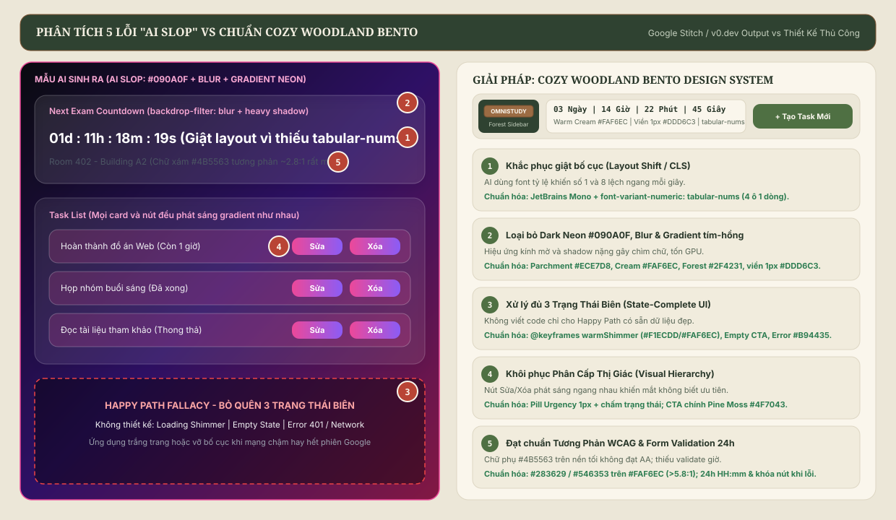

# Báo Cáo Phân Tích & Bóc Tách 5 Lỗi "AI Slop" Khi Thiết Kế Giao Diện

- **Dự án:** OmniStudy - Smart Exam & Task Planner
- **Màn hình thử nghiệm:** Focus Dashboard (Bento Grid)
- **Công cụ sinh giao diện:** Google Stitch / v0.dev
- **Mục tiêu:** Nhận diện và phân tích chi tiết ít nhất 5 lỗi "AI Slop" (giao diện rập khuôn, thiếu tư duy kỹ thuật thực tế do AI sinh ra) và đưa ra giải pháp sửa đổi theo chuẩn Design System.

---

## 1. Prompt Thử Nghiệm Gửi Cho AI

```text
"Design a modern dark-mode productivity dashboard for a student exam and task planner called 'OmniStudy'. Include an exam countdown timer, a prioritized task list with urgency badges, and a daily schedule synced with Google Calendar. Use a dark theme with modern aesthetics."
```



---

## 2. Phân Tích 5 Lỗi "AI Slop" & Giải Pháp Khắc Phục

### Lỗi 1: Rung Lắc Bố Cục Khi Nhảy Số (Layout Shift do thiếu `tabular-nums` / Monospace)
- **Biểu hiện của AI:** AI sinh ra khối đồng hồ đếm ngược ngày thi (`03d : 14h : 22m : 45s`) bằng font chữ tỷ lệ thông thường (`Inter` hoặc `Roboto`). 
- **Lý do đây là lỗi nghiêm trọng:** Các ký tự số trong font tỷ lệ có bề ngang không bằng nhau (ví dụ: số `1` hẹp hơn nhiều so với số `8` hoặc `0`). Cứ mỗi giây trôi qua khi số cuối cùng nhảy, toàn bộ thẻ đếm ngược và các phần tử xung quanh bị co giãn ngang liên tục (hiện tượng Cumulative Layout Shift - CLS), gây cảm giác nghiệp dư và mỏi mắt khi người dùng để màn hình làm việc lâu.
- **Giải pháp chuẩn:** 
  - Chuyển toàn bộ các thành phần hiển thị số đếm sang font `JetBrains Mono`.
  - Khai báo bắt buộc thuộc tính CSS: `font-variant-numeric: tabular-nums;`.

---

### Lỗi 2: Lạm Dụng "Glassmorphism & Gradient" Lòe Loẹt (Style AI Rập Khuôn)
- **Biểu hiện của AI:** AI tự động phủ hiệu ứng đổ bóng mờ mịt (`box-shadow: 0 25px 50px -12px rgba(0, 0, 0, 0.5)`), nền kính mờ `backdrop-filter: blur(20px)` và các dải màu gradient tím - hồng pastel cho các thẻ Bento.
- **Lý do đây là lỗi nghiêm trọng:**
  - Làm giảm độ sắc nét và cấu trúc phân vùng của phong cách Bento Grid.
  - Khiến văn bản hiển thị trên các thẻ bị chìm, giảm độ tương phản nghiêm trọng đối với người dùng ban đêm.
  - Gây tốn tài nguyên GPU khi trình duyệt phải tính toán hiệu ứng blur thời gian thực trên màn hình lớn.
- **Giải pháp chuẩn:**
  - Bỏ toàn bộ gradient nền và bóng đổ nặng.
  - Sử dụng nền màu đen đặc chuẩn mực: Nền Canvas `#090A0F`, Thẻ Bento `#11131A`.
  - Phân tách cấu trúc bằng đường viền phẳng mảnh `1px solid #222634`.

---

### Lỗi 3: "Happy Path Fallacy" - Hoàn Toàn Bỏ Quên Các Trạng Thái Biên
- **Biểu hiện của AI:** Bản thiết kế AI tạo ra chỉ đẹp khi ở trạng thái "hoàn hảo": Có sẵn đúng 5 công việc, 1 kỳ thi với dữ liệu chữ ngắn gọn vừa khít chiều cao thẻ. AI không hề tính đến hoặc không vẽ các trạng thái: Đang tải (Loading), Danh sách rỗng (Empty), hoặc Mất mạng (Network Error).
- **Lý do đây là lỗi nghiêm trọng:** Trong thực tế, khi sinh viên mới mở app lần đầu thì chưa có task nào (Empty state); khi mạng yếu thì dữ liệu Google Calendar chưa về kịp (Loading skeleton); khi Access Token hết hạn thì API trả về lỗi 401 (Error state). Nếu lập trình viên chỉ code theo bản vẽ của AI, ứng dụng sẽ bị vỡ nát hoặc hiển thị màn hình trắng xóa khi gặp lỗi.
- **Giải pháp chuẩn:**
  - Bổ sung Shimmer Skeleton có kích thước tương đương thẻ thật cho trạng thái đang tải.
  - Thiết kế màn hình Empty State có hình minh họa nhẹ nhàng kèm nút kêu gọi hành động `+ Tạo công việc đầu tiên`.
  - Thiết kế khung Alert đỏ thông báo rõ nguyên nhân lỗi kèm nút `Thử lại`.

---

### Lỗi 4: Sụp Đổ Phân Cấp Thị Giác (Visual Hierarchy Collapse)
- **Biểu hiện của AI:** AI cho tất cả các thẻ Bento Card (Đếm ngược môn thi, Bảng task, Danh sách lịch Google, Nút bấm) có cùng một tông màu nền, độ nổi và kích thước tương đương nhau. Nút xóa, nút tạo mới và nhãn ưu tiên đều dùng màu sáng rực rỡ như nhau.
- **Lý do đây là lỗi nghiêm trọng:** Vi phạm nguyên tắc Heuristic về nhận thức. Người dùng mở ứng dụng lên nhưng mắt không biết phải nhìn vào đâu trước. Một task chỉ còn 1 tiếng nữa là hết hạn lại có độ nổi thị giác ngang với một cuộc họp đã diễn ra từ sáng.
- **Giải pháp chuẩn:**
  - Áp dụng nguyên tắc "Màu nổi bật dành cho việc khẩn cấp": Chỉ những task có hạn chót sát nút mới được cấp viền màu Đỏ `#EF4444` hoặc Cam `#F97316`.
  - Phân cấp nút bấm rõ ràng: Nút hành động chính (Primary CTA) màu Indigo `#6366F1`, các nút còn lại dùng kiểu viền xám tối giản (Outline/Ghost button).

---

### Lỗi 5: Độ Tương Phản Chữ Mờ Nhạt Không Đạt Chuẩn WCAG
- **Biểu hiện của AI:** Trên nền Dark Mode, AI dùng màu chữ xám đậm `#4B5563` hoặc `#374151` cho các nhãn phụ như ngày thi, phòng thi và số giờ còn lại.
- **Lý do đây là lỗi nghiêm trọng:** Khi đo bằng công cụ WebAIM Contrast Checker, tỷ lệ tương phản giữa chữ xám `#4B5563` và nền `#11131A` chỉ đạt xấp xỉ `2.8:1`, vi phạm nghiêm trọng tiêu chuẩn tiếp cận Web Accessibility (yêu cầu tối thiểu `4.5:1` cho chuẩn AA). Người dùng xem trên màn hình có độ sáng trung bình hoặc phòng nhiều ánh sáng sẽ hầu như không thể đọc được thông tin.
- **Giải pháp chuẩn:**
  - Nâng toàn bộ màu chữ phụ lên tối thiểu `#9CA3AF` (đạt tỷ lệ tương phản `6.2:1`).
  - Tiêu đề chính bắt buộc dùng `#F3F4F6` (đạt tỷ lệ tương phản `15.8:1`, vượt chuẩn AAA).

---

## 3. Kết Luận & Bài Học Thực Tiễn Cho Lập Trình Viên Frontend

AI là một công cụ tạo mẫu (Prototyping) rất nhanh, nhưng AI không có tư duy thực chiến về **Accessibility**, **State Management**, và **Hiệu năng Render**. 

Là một lập trình viên Frontend chuyên nghiệp, ta không bao giờ sao chép nguyên xi giao diện AI sinh ra. Luôn phải soi xét qua 4 bộ lọc:
1. Font số liệu đã có `tabular-nums` chưa?
2. Đã có đủ 3 trạng thái Loading / Empty / Error chưa?
3. Màu sắc có tuân thủ Design Tokens và đạt chuẩn tương phản WCAG không?
4. Cấu trúc có phẳng, sắc nét và tối ưu cho người dùng hay đang lạm dụng hiệu ứng thừa thãi?
