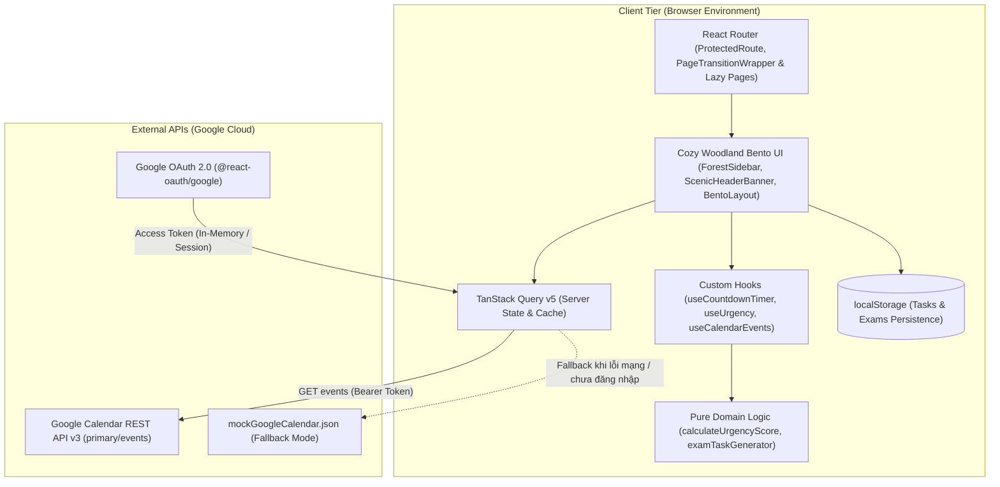
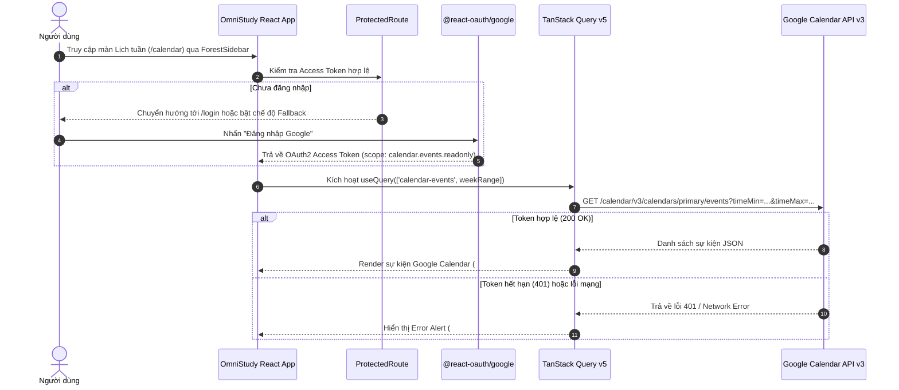

# System Architecture Specification - OmniStudy

## 1. Tổng Quan Kiến Trúc Hệ Thống (Client-Side SPA Architecture)

**OmniStudy** được thiết kế theo mô hình **Client-Side Single-Page Application (SPA)** xây dựng trên nền tảng **React 18 + TypeScript 5 + Vite 5**, hoàn toàn không sử dụng Backend riêng hay cơ sở dữ liệu máy chủ (theo phạm vi đã chốt trong [product.md](./product.md)).

Lý do lựa chọn kiến trúc thuần Client-Side:
1. **Phù hợp với mục tiêu đào tạo Frontend 7 buổi:** Tập trung tối đa vào nền tảng HTML/CSS, TypeScript, React component tree, Form UX, quản lý Server State và tối ưu hiệu năng trình duyệt (Core Web Vitals).
2. **Không tốn chi phí hạ tầng máy chủ (Zero-Cost Hosting):** Lưu trữ dữ liệu cá nhân (`tasks`, `exams`) trực tiếp trên trình duyệt qua `localStorage` và giao tiếp trực tiếp với **Google Calendar API v3** thông qua Google OAuth 2.0 phía Client.
3. **Sẵn sàng hoạt động ngoại tuyến / dự phòng:** Khi người dùng chưa đăng nhập Google hoặc gặp lỗi mạng, hệ thống tự động chuyển sang dữ liệu mẫu (`mockGoogleCalendar.json`) để giao diện lịch biểu vẫn vận hành đầy đủ.

---

## 2. Luồng Dữ Liệu & Tích Hợp Cốt Lõi (Core Data Flows)

### 2.1. Luồng Xác Thực Google OAuth 2.0 & Đồng Bộ Google Calendar API v3

### 2.2. Luồng Tính Điểm Khẩn Cấp & Tự Động Sinh Task Ôn Thi

1. **Dynamic Urgency Calculation (`urgency-calculator.ts`):**
   - Toàn bộ các hàm tính $U \in [0, 100]$, phân loại `UrgencyTier` (`OVERDUE`, `EXTREME`, `HIGH`, `MODERATE`, `LOW`), tổng hợp thời lượng công việc trong ngày (`Daily Stats`, ví dụ `8.5h`) và sắp xếp danh sách task đều là **Pure Functions** chạy trên TypeScript, dễ viết unit test và không phụ thuộc React State.
2. **Smart Exam Task Generator (`exam-task-generator.ts`):**
   - Khi người dùng tạo kỳ thi mới hoặc nhấn *"Tự động phân bổ task ôn vào lịch"* trong **Exam Prep Drawer**, hệ thống tính số ngày còn lại $N$ trước `examDate`, duyệt qua $M$ chủ đề chưa hoàn thành (ví dụ `2` chủ đề còn lại khi `Readiness = 60%` với `3/5` chủ đề đã xong) và sinh ra $M$ công việc mới có `basePriority = 3`, chia đều hạn chót về trước ngày thi rồi cập nhật đồng thời vào `localStorage`, Dashboard và Lịch tuần.
3. **Cô lập Re-render cho Đồng hồ đếm ngược (`useCountdownTimer`):**
   - Hook đếm ngược từng giây chỉ cập nhật state bên trong `ExamCountdownWidget`, tách biệt hoàn toàn với `UrgencyTaskList` để không gây re-render danh sách công việc mỗi giây.

### 2.3. Kiến Trúc Shell Layout & Hệ Thống Chuyển Động (Shell & Motion Architecture)

1. **Application Shell (`BentoLayout`):**
   - Bên trái: `ForestSidebar` rộng cố định `248px` nền `#2F4231` (trên màn hình `< 1024px` tự động chuyển thành ngăn kéo trượt).
   - Phía trên vùng nội dung: `ScenicHeaderBanner` hiển thị cảnh quan thiên nhiên rừng thông tối giản (không nhân vật game), lời chào, ngày/mùa, đồng hồ 24h (`tabular-nums`), avatar và nút `+ Thêm Lịch Thi`.
   - Vùng nội dung chính trên màn Dashboard sử dụng **Lưới Bento 12 cột**:
     - **Hàng 1:** `ExamCountdownWidget` (`5 cột`, đếm ngược 4 cột trên 1 hàng ngang) + `Daily Stats` (`7 cột`, thống kê tổng giờ và phân bố khẩn cấp).
     - **Hàng 2:** `UrgencyTaskList` (`8 cột`) + `Mini Schedule` (`4 cột`, lịch học ngắn trong ngày & khoảng trống Time-blocking).
2. **Kiểm soát Chuyển động (Motion Rules):**
   - `PageTransitionWrapper`: chuyển cảnh cross-fade + trượt nhẹ dọc `280ms cubic-bezier(0.22, 1, 0.36, 1)` giữa các route.
   - `ExamPrepDrawer`: ngăn kéo trượt ngang từ cạnh phải `360ms cubic-bezier(0.16, 1, 0.3, 1)`.
   - `UrgencyTaskList`: stagger `35ms/step` (tối đa `210ms`), hiệu ứng hover thẻ nâng nhẹ `-2px`.
   - `ScenicHeaderBanner`: hiệu ứng CSS ambient nhẹ cho mây trôi và tán lá/thông lay.
   - Tuân thủ bắt buộc `@media (prefers-reduced-motion: reduce)` trên toàn ứng dụng để bảo vệ khả năng tiếp cận.

---

## 3. Chiến Lược Xử Lý 3 Trạng Thái Biên (State-Complete UI)

Mỗi thành phần hiển thị dữ liệu (Dashboard Task Board, Exam Countdown, Weekly Calendar, Exam Prep Drawer) đều bắt buộc xử lý đầy đủ 3 nhánh trạng thái dựa trên cờ của TanStack Query (`isLoading`, `isError`, `data`):
- **Loading:** Render **Warm Shimmer Skeleton** (`@keyframes warmShimmer` quét ngang trên nền `--bg-surface-2` `#F1ECDD` / `--bg-surface-1` `#FAF6EC`) đúng kích thước thẻ thật để giữ `CLS = 0`.
- **Empty:** Render thông báo ngữ cảnh trên nền `#FAF6EC` viền `1px solid #DDD6C3` kèm nút hành động chính (Primary CTA `#4F7043`).
- **Error:** Render khung cảnh báo nền `--semantic-danger-bg` (`#FBEAE7`), viền `1px solid #D97C6E`, chữ `#9A3326` nêu rõ nguyên nhân và nút `Thử lại` / `Đăng nhập lại Google`.
