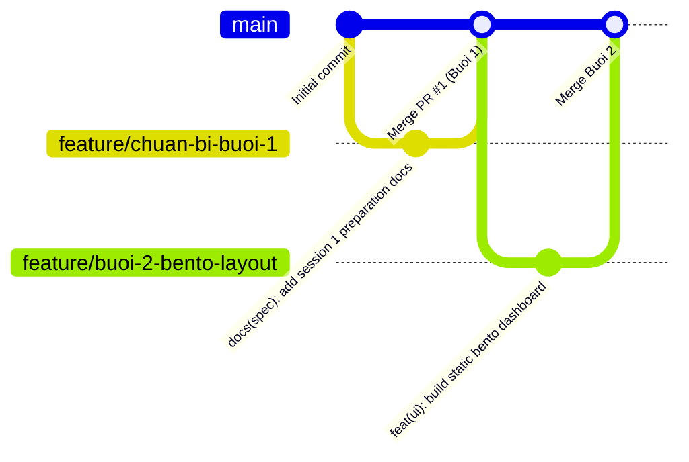

# Git Workflow Specification - OmniStudy

## 1. Chiến Lược Phân Nhánh (Branching Strategy)

Dự án **OmniStudy** áp dụng mô hình **GitHub Flow** đơn giản, bám sát tiến độ từng buổi học trong [roadmap.md](./roadmap.md):



### 1.1. Quy Định Các Nhánh
1. **`main` (Nhánh chính):** Luôn chứa mã nguồn sạch, chạy ổn định và có thể kiểm tra hoặc deploy bất cứ lúc nào.
2. **Nhánh tính năng theo buổi học (`feature/*`):**
   - Mỗi buổi học hoặc tính năng tách một nhánh riêng từ `main`, ví dụ:
     - `feature/chuan-bi-buoi-1`
     - `feature/buoi-2-bento-layout`
     - `feature/buoi-3-urgency-calculator`
     - `feature/buoi-4-react-components`
     - `feature/buoi-5-design-system-forms`
     - `feature/buoi-6-routing-google-calendar`
     - `feature/buoi-7-optimize-and-deploy`
   - Sau khi tự kiểm tra đạt toàn bộ tiêu chí nghiệm thu của buổi học, tạo Pull Request hợp nhất vào `main`.

---

## 2. Chuẩn Commit Message (Conventional Commits)

```text
<type>(<scope>): <subject>
```

- **`<type>`:** `feat`, `fix`, `refactor`, `perf`, `style`, `docs`, `chore`.
- **`<scope>`:** `task`, `exam`, `calendar`, `ui`, `docs`, `chore`.
- **`<subject>`:** Tiếng Anh ngắn gọn (tối đa 72 ký tự), động từ nguyên mẫu hiện tại, không viết hoa chữ cái đầu, không có dấu chấm ở cuối.

Ví dụ:
```text
feat(task): implement dynamic urgency score calculation
feat(exam): add useCountdownTimer hook with interval cleanup
feat(calendar): integrate Google Calendar API v3 with TanStack Query
fix(ui): enforce tabular-nums on countdown display
docs(worklog): update session 2 progress
```

---

## 3. Quy Trình Thực Hiện Mỗi Buổi Học

1. Cập nhật nhánh `main` mới nhất: `git checkout main && git pull origin main`.
2. Tạo nhánh mới cho buổi học: `git checkout -b feature/buoi-X-<ten-ngan>`.
3. Thực hiện đầy đủ các đầu việc trong [roadmap.md](./roadmap.md) và kiểm tra tiêu chí nghiệm thu (HTML/CSS, `tsc --noEmit`, `npm run lint`, `npm run build`, Lighthouse).
4. Cập nhật trạng thái buổi học tương ứng trong [worklog.md](./worklog.md).
5. Commit theo đúng chuẩn Conventional Commits, đẩy nhánh lên GitHub và tạo Pull Request vào `main`.
