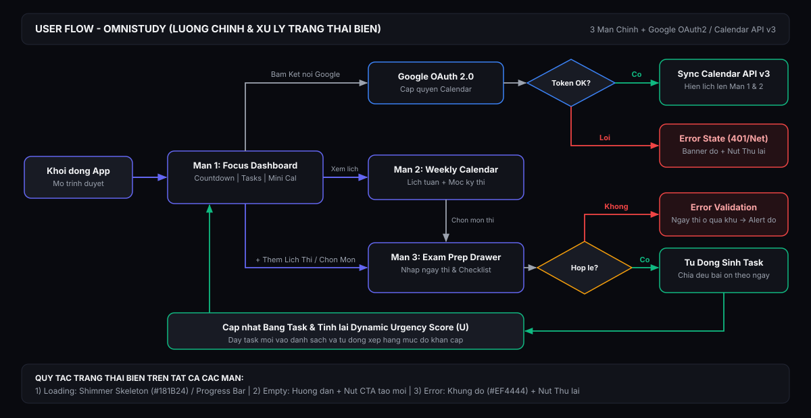
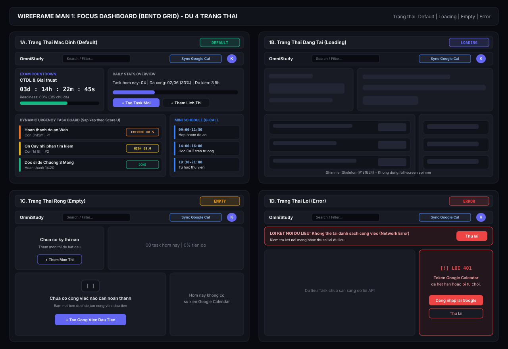
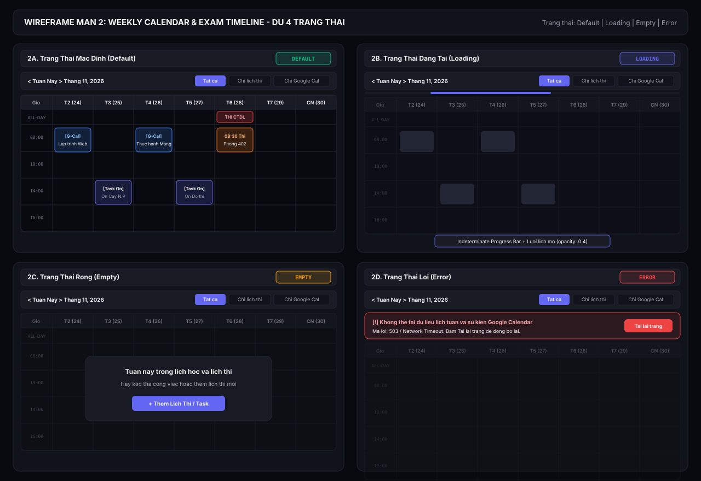
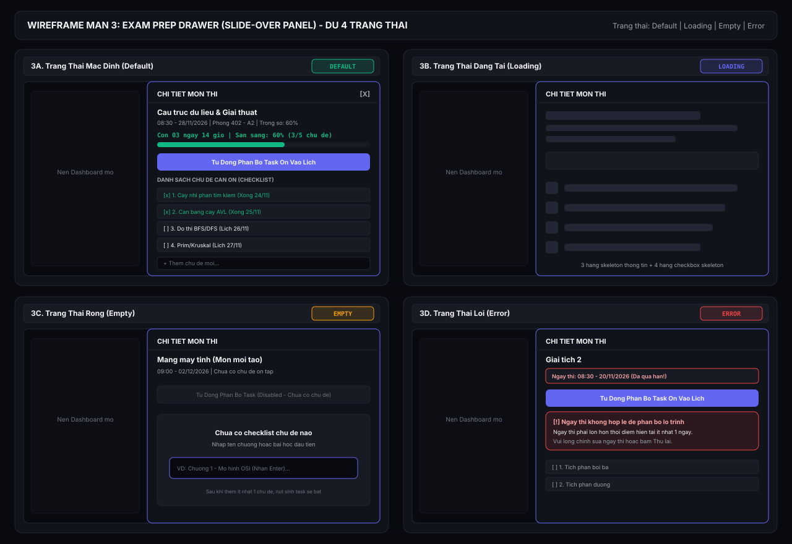
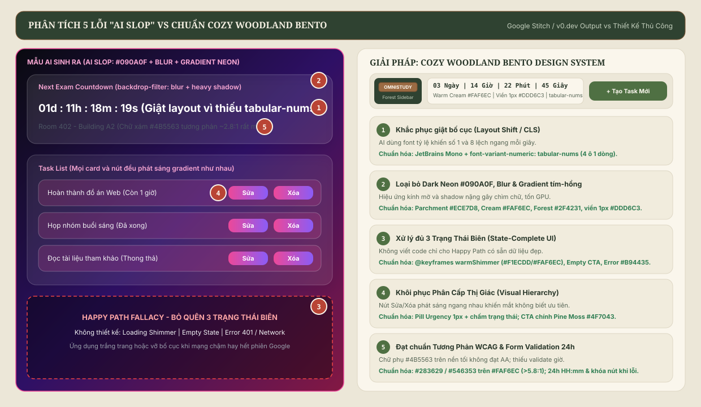
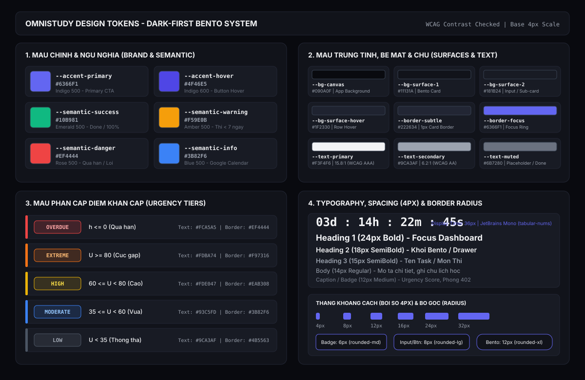

# Tài Liệu Chuẩn Bị Buổi 1 - OmniStudy (CLB ProPTIT Frontend)

- **Nhánh làm việc:** `feature/chuan-bi-buoi-1`
- **Ngày chuẩn hóa giao diện:** `Thứ Tư, 25/11/2026` (Cập nhật hệ thống Light-First Cozy Woodland Bento: `26/11/2026`)
- **Mục tiêu buổi học:** Chốt đề tài cá nhân xuyên suốt khóa học, vẽ User Flow và Wireframe 3 màn chính kèm đủ 3 trạng thái biên (Đang tải, Trống, Lỗi), phân tích ít nhất 5 lỗi "AI Slop" khi sinh giao diện tự động, và lập bảng Design Tokens trực quan.

---

## 1. Chốt Đề Tài & Phong Cách Thiết Kế

**OmniStudy - Smart Exam & Task Planner** là ứng dụng web quản lý công việc và lập kế hoạch ôn thi cá nhân theo phong cách **Light-First Cozy Woodland Bento** (lấy cảm hứng từ khung cảnh rừng thông và mặt hồ yên tĩnh Sherwood Island với các họa tiết lá và cây tối giản, không dùng nhân vật game hay hiệu ứng neon). Ứng dụng giải quyết tình trạng học dồn trước kỳ thi (cramming) và trễ hạn deadline bằng động cơ tự động tính **Điểm khẩn cấp động (Dynamic Urgency Score)** kết hợp **Bộ tự động phân bổ bài ôn trước kỳ thi (Exam Prep Kit)**. Hệ thống tích hợp trực tiếp **Google Calendar API v3** (xác thực qua Google OAuth 2.0) để đồng bộ lịch học cá nhân lên lịch tuần và hỗ trợ sắp xếp thời gian biểu trực quan.

- **Bố cục vỏ ứng dụng (Shell):** Thanh điều hướng trái **`ForestSidebar` (`248px`, nền `#2F4231`, biển gỗ `#9B6B43`)** + **`ScenicHeaderBanner`** (lời chào, ngày `Thứ Tư, 25/11/2026`, mùa/đồng hồ, nút `+ Thêm Lịch Thi`) + **Lưới Bento 12 cột (`BentoLayout`)** (Hàng 1: `ExamCountdownWidget` 5 cột + `Daily Stats` 7 cột; Hàng 2: `UrgencyTaskList` 8 cột + `Mini Schedule` 4 cột) + **`PageTransitionWrapper`**.
- **7 Điểm Nhất Quán Dữ Liệu Trên Toàn Bộ Tài Liệu & Hình Minh Họa:**
  1. **Lịch tháng 11/2026 chính xác:** Hôm nay là **`Thứ Tư, 25/11/2026`**; Lịch tuần từ **`Thứ 2 (23/11)`** đến **`CN (29/11)`** (làm nổi bật cột `Thứ 4 (25/11)`); Kỳ thi gần nhất là **`08:30 - Thứ Bảy, 28/11/2026`** (Phòng 402 - Giảng đường A2).
  2. **Tỷ lệ sẵn sàng kỳ thi (`Readiness %`):** Chính xác **`60% (3/5 chủ đề)`** gồm đúng 3 chủ đề đã hoàn thành (`1. Cây nhị phân tìm kiếm`, `2. Cân bằng cây AVL`, `3. Bảng băm & Hashing`) và 2 chủ đề còn lại (`4. Đồ thị & Duyệt BFS/DFS`, `5. Cây khung nhỏ nhất Prim/Kruskal`).
  3. **Đồng hồ đếm ngược 1 hàng ngang duy nhất:** 4 ô cân bằng (`03 Ngày | 14 Giờ | 22 Phút | 45 Giây`), tuyệt đối không xuống dòng chữ `Giây`.
  4. **100% `tabular-nums`:** Mọi đồng hồ đếm ngược, điểm khẩn cấp $U$, tỷ lệ phần trăm, số giờ và giờ lịch đều dùng `'JetBrains Mono'` kèm `font-variant-numeric: tabular-nums`.
  5. **Loading Skeleton Shimmer ấm áp:** Sử dụng `@keyframes warmShimmer` quét mượt trên dải màu `#F1ECDD` / `#FAF6EC`, không dùng spinner che toàn màn hình.
  6. **Dialog Modals chuẩn 24 giờ & Khóa Submit:** Các hộp thoại tạo Task / Lịch thi dùng định dạng **`HH:mm DD/MM/YYYY`** và tự động **`disabled` nút Submit** khi dữ liệu không hợp lệ.
  7. **Thống kê giờ làm việc nhất quán:** Tổng giờ dự kiến trong ngày là **`8.5h`**, khớp đúng tổng 4 công việc đang mở (`1.5h + 2.0h + 3.0h + 2.0h`).

- Tài liệu mô tả chi tiết đề tài và công nghệ: [README.md](../../README.md)
- Lộ trình chi tiết 7 buổi học: [roadmap.md](../roadmap.md)

---

## 2. User Flow & Wireframe 3 Màn Chính (Đủ 3 Trạng Thái Biên)

### 2.1. Sơ Đồ Luồng Người Dùng (User Flow)

### 2.2. Wireframe Màn 1: Focus Dashboard (Cozy Woodland Bento Grid)

### 2.3. Wireframe Màn 2: Weekly Calendar & Exam Timeline (23/11 - 29/11/2026)

### 2.4. Wireframe Màn 3: Exam Prep Drawer (Slide-Over & 24h Validation)

### 2.5. Bảng Đối Chiếu 3 Trạng Thái Bắt Buộc Trên 3 Màn

| Màn hình | Đang tải (Loading) | Trống (Empty) | Lỗi (Error) |
| :--- | :--- | :--- | :--- |
| **1. Focus Dashboard** | Warm-cream Shimmer Skeleton (`@keyframes warmShimmer` trên `#F1ECDD` / `#FAF6EC`) đúng kích thước Countdown, Daily Stats, 4 thẻ Task và Mini Schedule | Họa tiết lá cây tối giản nét `1.75px` (`#4F7043`), thông báo chưa có task/kỳ thi kèm nút `+ Tạo Công Việc Đầu Tiên` và `+ Thêm Môn Thi` | Khung nền `#FBEAE7` viền `1px solid #B94435` chữ `#9A3326` tại Mini Schedule (lỗi Google Calendar `401`) hoặc banner lỗi mạng kèm nút `Đăng nhập lại Google` / `Thử lại` |
| **2. Weekly Calendar** | Thanh Indeterminate Progress Bar (`#4F7043` trên `#F1ECDD`) ở đỉnh kết hợp các khối lịch warm shimmer trên lưới mờ (`opacity: 0.45`) | Lưới lịch `23/11 - 29/11` kèm thẻ trung tâm `#FAF6EC` thông báo tuần trống và nút `+ Thêm Lịch Thi / Task` (`#4F7043`) | Thanh Alert `#FBEAE7` viền `#B94435` trên đầu bảng lịch báo mã lỗi (`503 / Network Timeout`) kèm nút `Tải lại trang` |
| **3. Exam Prep Drawer** | 3 dòng skeleton thông tin môn thi, 1 nút skeleton và 5 dòng checkbox skeleton chạy `@keyframes warmShimmer` | Ô nhập chủ đề đầu tiên viền focus `#4F7043`; nút sinh lộ trình ở trạng thái `disabled` (`#EAE6D9`, chữ `#626F5F`) cho tới khi có ít nhất 1 chủ đề | Ô nhập thời gian 24h (`HH:mm DD/MM/YYYY`) viền `#B94435`, nút Submit bị `disabled` và hiện Error Alert `#FBEAE7` chữ `#9A3326` khi ngày thi ở quá khứ |

- Tài liệu đặc tả đầy đủ User Flow (Mermaid + ASCII), 3 màn hình và Modals 24h: [wireframes.md](../wireframes.md)

---

## 3. Sinh Giao Diện Bằng AI & Phân Tích 5 Lỗi "AI Slop"

Sử dụng công cụ sinh giao diện AI (Google Stitch / v0.dev) với prompt tạo màn **Focus Dashboard** của OmniStudy, sau đó kiểm duyệt các mẫu dark/neon/glassmorphic rập khuôn của AI và chuẩn hóa về hệ **Cozy Woodland Bento**:

| STT | Lỗi AI Slop | Biểu hiện & Lý do cần sửa | Giải pháp theo Cozy Woodland Bento |
| :---: | :--- | :--- | :--- |
| 1 | Thiếu `tabular-nums` & xuống dòng đồng hồ | Font tỷ lệ khiến số `1` và `8` lệch ngang gây CLS mỗi giây; chữ `Giây` bị rớt dòng | Dùng `'JetBrains Mono'` + `tabular-nums`; khóa 4 ô `03 Ngày \| 14 Giờ \| 22 Phút \| 45 Giây` trên 1 hàng ngang |
| 2 | Lạm dụng nền tối `#090A0F`, Blur & Gradient tím-hồng | `backdrop-filter: blur(20px)`, shadow nặng và gradient tím-hồng gây mỏi mắt, chìm chữ và tốn GPU | Dùng Warm Parchment `#ECE7D8`, Forest Sidebar `#2F4231`, Warm Cream `#FAF6EC`, viền mảnh `1px solid #DDD6C3` |
| 3 | Happy Path Fallacy & thiếu khóa form | Bỏ quên trạng thái Loading, Empty, Error 401 và cho phép submit ngày quá khứ / AM-PM nhập nhằng | Bổ sung `@keyframes warmShimmer`, Empty CTA, Error `#B94435`, định dạng `24h (HH:mm DD/MM/YYYY)` và `disabled` submit |
| 4 | Sụp đổ phân cấp thị giác | Tất cả thẻ, nút Sửa/Xóa đều phát sáng ngang nhau, dùng viền trái neon dày rườm rà | Dùng `1px` border + chấm trạng thái + organic pill badge theo 5 Urgency Tiers; CTA chính Pine Moss `#4F7043` |
| 5 | Tương phản kém & sai lệch số liệu | Chữ xám `#4B5563` trên nền tối chỉ đạt `~2.8:1` (trượt WCAG AA); tổng giờ thống kê lệch với danh sách task | Chữ chính `#283629` (`>11:1`), phụ `#546353` (`>5.8:1`) trên `#FAF6EC`; khớp `8.5h = 1.5 + 2.0 + 3.0 + 2.0` và `60% = 3/5` |

- Báo cáo phân tích chi tiết Prompt và 5 lỗi AI Slop: [ai-review.md](../ai-review.md)

---

## 4. Bảng Design Tokens Chuẩn Hóa (Cozy Woodland Bento)

### 4.1. Bảng Màu Bề Mặt, Sidebar, Chữ & Ngữ Nghĩa (16 Swatches)

| Nhóm màu | Màu mẫu | Token | Mã Hex | Ứng dụng |
| :--- | :---: | :--- | :--- | :--- |
| Nền tổng thể |  | `--bg-canvas` | `#ECE7D8` | Warm Parchment - Nền tổng thể toàn trang |
| Thanh điều hướng |  | `--bg-sidebar` | `#2F4231` | Deep Forest Pine - `ForestSidebar` (`248px`, hover `#3B513D`, tip `#4A5F44`, wood sign `#9B6B43` viền `#7A5130` chữ `#FDF9F0`) |
| Bề mặt chính |  | `--bg-surface-1` | `#FAF6EC` | Warm Cream - Thẻ Bento Grid, ExamPrepDrawer, Dialog Modals |
| Bề mặt phụ |  | `--bg-surface-2` | `#F1ECDD` | Soft Oat - Thẻ Task con, Input, Warm Shimmer Skeleton |
| Trạng thái Hover |  | `--bg-surface-hover` | `#E7E0CC` | Nền thẻ con / dòng dữ liệu / nút phụ khi di chuột |
| Viền cấu trúc |  | `--border-subtle` | `#DDD6C3` | Viền mảnh `1px solid` phân tách giữa các khối Bento |
| Viền Focus |  | `--border-focus` | `#4F7043` | Viền vòng sáng `:focus-visible` trên Input, Button, Card |
| Chữ chính |  | `--text-primary` | `#283629` | Forest Ink - Tiêu đề chính, tên môn, số đếm (`>11:1` AAA; chữ trên Sidebar `#F4EFE2`) |
| Chữ phụ |  | `--text-secondary` | `#546353` | Sage Bark - Nhãn phụ, phòng thi, ngày giờ (`>5.8:1` AA; phụ Sidebar `#C6D1BF`) |
| Chữ mờ |  | `--text-muted` | `#626F5F` | Moss Muted - Placeholder, task đã gạch ngang hoàn thành |
| Màu nhấn chính |  | `--accent-primary` | `#4F7043` | Pine Moss - Nút hành động chính (Primary CTA) |
| Màu nhấn (Hover) |  | `--accent-hover` | `#3F5B35` | Trạng thái di chuột của nút chính |
| Thành công |  | `--semantic-success` | `#2E7D52` | Hoàn thành task, tiến độ ôn (nền pill `#E3F2EA`) |
| Cảnh báo |  | `--semantic-warning` | `#B87A1E` | Lịch thi dưới 7 ngày, cảnh báo nhẹ (chữ `#8A580F`, nền `#FBF1DC`) |
| Lỗi / Nguy hiểm |  | `--semantic-danger` | `#B94435` | Quá hạn, thi dưới 24h, Error Alert & validation (chữ `#9A3326`, nền `#FBEAE7`) |
| Thông tin (API) |  | `--semantic-info` | `#3A6F88` | Sự kiện đồng bộ từ Google Calendar API v3 (chữ `#2B566B`, nền `#E5F1F6`) |

### 4.2. Bảng Màu 5 Cấp Bậc Điểm Khẩn Cấp Động (10 Swatches Urgency Tiers)

Các thẻ công việc dùng **viền mảnh `1px solid` + chấm trạng thái + organic pill badge** (không dùng viền trái neon dày):

| Màu mẫu (Chữ / Viền) | Phân cấp | Điều kiện | Màu chữ | Màu nền Pill | Màu viền `1px` |
| :---: | :--- | :--- | :--- | :--- | :--- |
|   | `OVERDUE` | $h \le 0$ (Quá hạn) | `#9A3326` | `#F9DFDA` | `#D97C6E` |
|   | `EXTREME` | $U \ge 80$ (Cực gấp) | `#9E4718` | `#FBE6D4` | `#E09866` |
|   | `HIGH` | $60 \le U < 80$ (Ưu tiên cao) | `#8A580F` | `#FBF0D6` | `#D9AE59` |
|   | `MODERATE` | $35 \le U < 60$ (Vừa phải) | `#2B566B` | `#E4F0F5` | `#7FAAC0` |
|   | `LOW` | $U < 35$ (Thong thả) | `#546353` | `#EAE6D9` | `#C9C2AE` |

### 4.3. Hệ Thống Font Chữ, Thang Khoảng Cách, Bo Góc & Chuyển Động

- **Font Display (`--font-display`):** `'Fraunces'`, `'Lora'`, Georgia, serif (dùng cho tiêu đề trang, lời chào banner, tên kỳ thi).
- **Font Giao diện (`--font-sans`):** `'Plus Jakarta Sans'`, `'Inter'`, -apple-system, sans-serif.
- **Font Số liệu & Đếm ngược (`--font-mono`):** `'JetBrains Mono'`, monospace (bắt buộc kèm `font-variant-numeric: tabular-nums` trên 100% đồng hồ đếm ngược, điểm $U$, `%`, số giờ và lịch).
- **Thang khoảng cách (bội số `4px`):** `4px` (`space-1`), `8px` (`space-2`), `12px` (`space-3`), `16px` (`space-4`), `24px` (`space-6`), `32px` (`space-8`).
- **Độ bo góc (Border Radius):**
  - Thẻ Bento chính & Modal Dialog / Drawer: `16px` (`rounded-2xl`).
  - Thẻ Task con & Ô nhập liệu Input: `12px` (`rounded-xl`).
  - Nhãn Badge: `8px` (`rounded-lg`).
  - Nút Pill & Urgency Pill: `9999px` (`rounded-full`).
- **Chuyển động (Motion):** Chuyển trang `280ms cubic-bezier(0.22, 1, 0.36, 1)`, trượt Drawer `360ms cubic-bezier(0.16, 1, 0.3, 1)`, stagger Task `35ms/step` (tối đa `210ms`), hover thẻ `-2px`, hiệu ứng `@keyframes warmShimmer` cho skeleton, và bắt buộc hỗ trợ `@media (prefers-reduced-motion: reduce)`.

- Tài liệu đặc tả đầy đủ Design System: [DESIGN.md](../../DESIGN.md)
