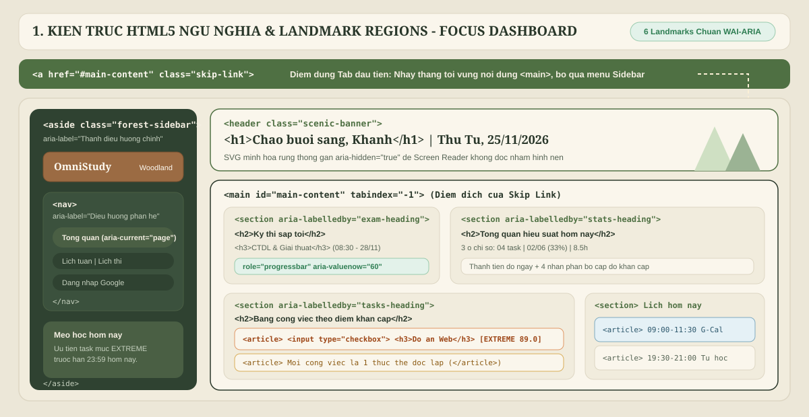
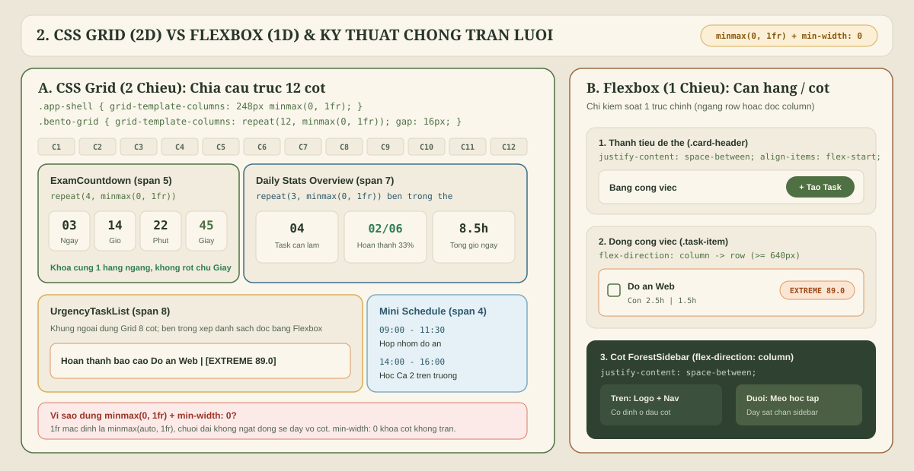
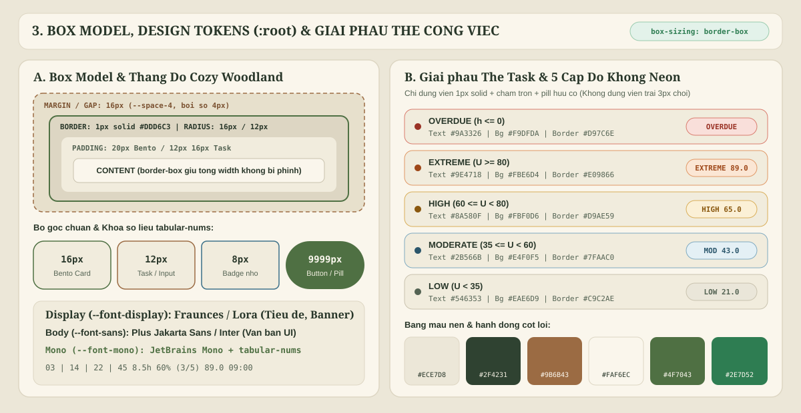
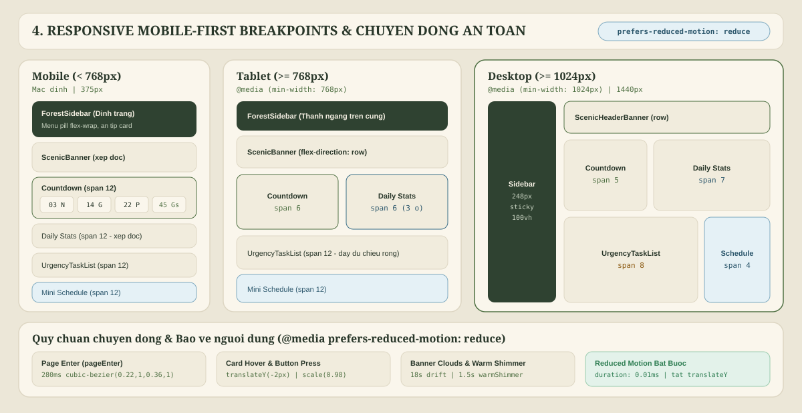
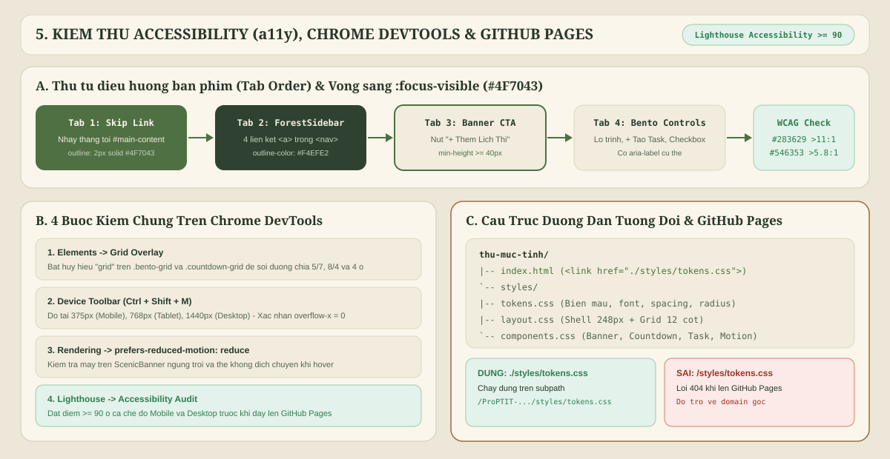
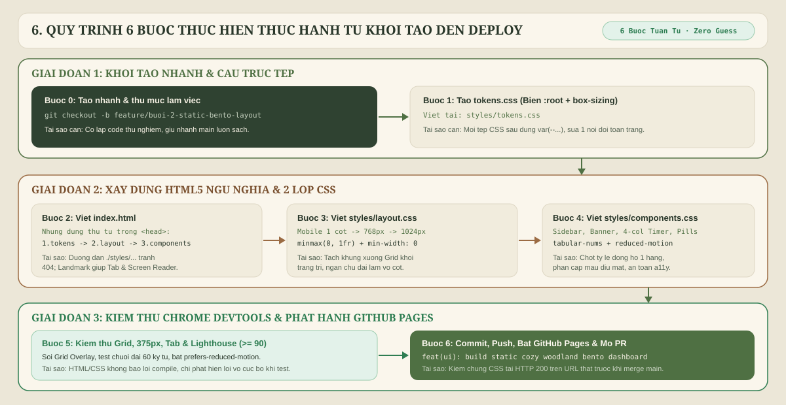

# Tài Liệu Chuẩn Bị - HTML5 Ngữ Nghĩa & CSS Bento Grid (OmniStudy)

## Phần 1. Kiến trúc HTML5 ngữ nghĩa và Vỏ ứng dụng



### I. Phân vùng Landmark Regions trên Focus Dashboard

#### 1. Vai trò của thẻ ngữ nghĩa đối với trình duyệt và Screen Reader

**A. Cơ chế định vị vùng Landmark**

Trình duyệt và trình đọc màn hình không hiểu ý nghĩa giao diện nếu toàn bộ khối chỉ dùng thẻ `<div>`. Thẻ HTML5 ngữ nghĩa tạo ra bản đồ vùng giúp người dùng bàn phím và công cụ hỗ trợ di chuyển nhanh giữa các khu vực chính.

- Mọi vùng điều hướng, banner, nội dung chính và thẻ dữ liệu độc lập cần dùng đúng thẻ chuẩn WAI-ARIA.
- Các hình minh họa SVG mang tính trang trí gắn `aria-hidden="true"` để không làm nhiễu trình đọc màn hình.
- Liên kết nhảy nhanh (Skip Link) đặt ngay đầu `<body>` giúp bỏ qua menu bên trái khi nhấn phím `Tab`.

**B. Bảng ánh xạ vùng giao diện sang thẻ HTML5**

| Khu vực giao diện | Thẻ HTML5 sử dụng | Thuộc tính hỗ trợ Accessibility | Vai trò cấu trúc |
| :--- | :--- | :--- | :--- |
| Liên kết nhảy nhanh | `<a class="skip-link">` | `href="#main-content"` | Nhảy thẳng tới vùng nội dung trọng tâm |
| Thanh điều hướng trái | `<aside class="forest-sidebar">` | `aria-label="Thanh điều hướng chính"` | Chứa thương hiệu, menu và thẻ mẹo học tập |
| Danh sách liên kết trang | `<nav>` | `aria-label="Điều hướng phân hệ"` | Đánh dấu mục hiện tại bằng `aria-current="page"` |
| Banner đầu trang | `<header class="scenic-banner">` | SVG nền gắn `aria-hidden="true"` | Chứa lời chào `<h1>`, ngày giờ và nút hành động |
| Vùng Bento Grid chính | `<main id="main-content">` | `tabindex="-1"` | Đích nhận focus duy nhất của toàn trang |
| 4 khối Bento lớn | `<section>` | `aria-labelledby="<id-tiêu-đề>"` | Phân tách Kỳ thi, Thống kê, Công việc, Lịch ngày |
| Từng thẻ việc và lịch | `<article>` | Chứa tiêu đề `<h3>` | Biểu diễn từng mục dữ liệu độc lập |

#### 2. Cấu trúc khung HTML5 cốt lõi của trang

**A. Khung vỏ ứng dụng và Skip Link**

```html
<!DOCTYPE html>
<html lang="vi">
<head>
  <meta charset="UTF-8">
  <meta name="viewport" content="width=device-width, initial-scale=1.0">
  <title>OmniStudy - Focus Dashboard</title>
  <link rel="stylesheet" href="./styles/tokens.css">
  <link rel="stylesheet" href="./styles/layout.css">
  <link rel="stylesheet" href="./styles/components.css">
</head>
<body>
  <a href="#main-content" class="skip-link">Chuyển tới nội dung chính</a>

  <div class="app-shell">
    <aside class="forest-sidebar" aria-label="Thanh điều hướng chính">
      <div class="sidebar-top">
        <div class="wood-sign">
          <p class="wood-sign-title">OmniStudy</p>
          <span class="wood-sign-tag">Woodland</span>
        </div>

        <nav aria-label="Điều hướng phân hệ">
          <ul class="sidebar-nav-list">
            <li><a href="#main-content" class="sidebar-link" aria-current="page"><span>Tổng quan</span><span class="sidebar-badge mono-num">04</span></a></li>
            <li><a href="#lich-tuan" class="sidebar-link"><span>Lịch tuần</span><span class="sidebar-badge mono-num">23-29</span></a></li>
            <li><a href="#lich-thi" class="sidebar-link"><span>Lịch thi</span><span class="sidebar-badge mono-num">01</span></a></li>
            <li><a href="#google-sync" class="sidebar-link"><span>Đăng nhập Google</span></a></li>
          </ul>
        </nav>
      </div>

      <div class="sidebar-tip-card">
        <p class="sidebar-tip-title">Mẹo học hôm nay</p>
        <p class="sidebar-tip-text">Hoàn thành các task mức EXTREME trước 23:59 và giữ nhịp ôn 2 chủ đề còn lại trước Thứ Bảy.</p>
      </div>
    </aside>

    <div class="main-workspace page-enter">
      <header class="scenic-banner">
        <svg class="scenic-bg-svg" viewBox="0 0 1200 220" preserveAspectRatio="xMidYMid slice" aria-hidden="true">
          <rect width="1200" height="220" fill="#FAF6EC" />
          <g class="banner-cloud" opacity="0.7">
            <ellipse cx="780" cy="48" rx="68" ry="18" fill="#F1ECDD" />
            <ellipse cx="960" cy="36" rx="54" ry="14" fill="#F1ECDD" />
          </g>
          <path d="M0 168 Q260 125 560 152 T1200 130 L1200 220 L0 220 Z" fill="#E3ECDB" />
          <path d="M0 185 Q420 156 820 176 T1200 162 L1200 220 L0 220 Z" fill="#CFE0C3" />
          <rect x="820" y="178" width="380" height="42" fill="#DCEAF0" />
          <polygon points="1030,178 1055,105 1080,178" fill="#4F7043" />
          <polygon points="1072,178 1094,120 1116,178" fill="#3F5B35" />
          <polygon points="1125,178 1152,96 1179,178" fill="#2F4231" />
        </svg>

        <div class="scenic-banner-content">
          <div>
            <h1 class="banner-greeting">Chào buổi sáng, Khánh</h1>
            <p class="banner-subtitle">Thứ Tư, 25/11/2026 - Khu vườn kế hoạch ôn thi tuần 23/11 đến 29/11</p>
          </div>
          <div class="banner-actions">
            <span class="banner-meta-pill">Cuối Thu</span>
            <span class="banner-meta-pill mono-num">09:00</span>
            <span class="avatar-circle" aria-label="Tài khoản Khánh">K</span>
            <button type="button" class="btn-primary">+ Thêm Lịch Thi</button>
          </div>
        </div>
      </header>
```

**B. Khung 4 khối Bento trong vùng Main**

```html
      <main id="main-content" class="bento-grid" tabindex="-1">
        <section class="bento-card bento-countdown" aria-labelledby="exam-heading">
          <div class="card-header">
            <div>
              <h2 id="exam-heading" class="card-title">Kỳ thi sắp tới</h2>
              <p class="card-caption mono-num">08:30 - Thứ Bảy, 28/11/2026</p>
            </div>
            <span class="urgency-pill tier-high"><span class="status-dot" aria-hidden="true"></span><span>Còn 3 ngày</span></span>
          </div>

          <div>
            <h3 class="exam-name">Cấu trúc dữ liệu &amp; Giải thuật</h3>
            <p class="card-caption">Phòng 402 - Giảng đường A2 | Trọng số: <span class="mono-num">60%</span></p>
          </div>

          <div class="countdown-grid" aria-label="Đồng hồ đếm ngược kỳ thi">
            <div class="countdown-box"><span class="countdown-value mono-num">03</span><span class="countdown-unit">Ngày</span></div>
            <div class="countdown-box"><span class="countdown-value mono-num">14</span><span class="countdown-unit">Giờ</span></div>
            <div class="countdown-box"><span class="countdown-value mono-num">22</span><span class="countdown-unit">Phút</span></div>
            <div class="countdown-box"><span class="countdown-value mono-num">45</span><span class="countdown-unit">Giây</span></div>
          </div>

          <div class="readiness-row">
            <div class="readiness-meta">
              <span>Độ sẵn sàng ôn tập</span>
              <span class="mono-num">60% (3/5 chủ đề)</span>
            </div>
            <div class="progress-track" role="progressbar" aria-valuenow="60" aria-valuemin="0" aria-valuemax="100" aria-label="Tiến độ ôn tập kỳ thi">
              <div class="progress-fill-success" style="width: 60%;"></div>
            </div>
          </div>

          <div><a href="#exam-drawer" class="btn-outline">Mở lộ trình ôn tập (còn 2 chủ đề)</a></div>
        </section>

        <section class="bento-card bento-stats" aria-labelledby="stats-heading">
          <div class="card-header">
            <div>
              <h2 id="stats-heading" class="card-title">Tổng quan hiệu suất hôm nay</h2>
              <p class="card-caption">Thống kê tự động theo danh sách công việc đang mở</p>
            </div>
            <button type="button" class="btn-primary">+ Tạo Task Mới</button>
          </div>

          <div class="stats-grid">
            <div class="stat-tile"><span class="stat-label">Task cần làm</span><span class="stat-value mono-num">04</span><span class="stat-sub">Đang chờ xử lý</span></div>
            <div class="stat-tile"><span class="stat-label">Đã hoàn thành</span><span class="stat-value mono-num">02/06 (33%)</span><span class="stat-sub">Mục tiêu ngày</span></div>
            <div class="stat-tile"><span class="stat-label">Giờ học dự kiến</span><span class="stat-value mono-num">8.5h</span><span class="stat-sub mono-num">1.5h + 2.0h + 3.0h + 2.0h</span></div>
          </div>

          <div class="readiness-row">
            <div class="readiness-meta"><span>Tiến độ hoàn thành trong ngày</span><span class="mono-num">33%</span></div>
            <div class="progress-track" role="progressbar" aria-valuenow="33" aria-valuemin="0" aria-valuemax="100" aria-label="Tiến độ công việc trong ngày">
              <div class="progress-fill-accent" style="width: 33%;"></div>
            </div>
          </div>

          <div class="tier-summary-strip" aria-label="Phân bố cấp độ khẩn cấp">
            <span class="urgency-pill tier-extreme mono-num"><span class="status-dot" aria-hidden="true"></span>01 EXTREME</span>
            <span class="urgency-pill tier-high mono-num"><span class="status-dot" aria-hidden="true"></span>01 HIGH</span>
            <span class="urgency-pill tier-moderate mono-num"><span class="status-dot" aria-hidden="true"></span>01 MODERATE</span>
            <span class="urgency-pill tier-low mono-num"><span class="status-dot" aria-hidden="true"></span>01 LOW</span>
          </div>
        </section>

        <section class="bento-card bento-tasks" aria-labelledby="tasks-heading">
          <div class="card-header">
            <div>
              <h2 id="tasks-heading" class="card-title">Bảng công việc theo điểm khẩn cấp</h2>
              <p class="card-caption">Tổng thời lượng đang mở: <span class="mono-num">8.5h</span></p>
            </div>
            <span class="btn-outline">Tất cả môn</span>
          </div>

          <div class="task-list">
            <article class="task-item tier-extreme">
              <div class="task-main">
                <input type="checkbox" class="task-checkbox" aria-label="Đánh dấu hoàn thành Hoàn thành báo cáo Đồ án Web">
                <div class="task-content">
                  <h3 class="task-title">Hoàn thành báo cáo Đồ án Web</h3>
                  <p class="task-meta mono-num">Còn 2.5h | Ước tính: 1.5h | P4 | Lập trình Web</p>
                </div>
              </div>
              <span class="urgency-pill tier-extreme mono-num"><span class="status-dot" aria-hidden="true"></span><span>EXTREME · 89.0</span></span>
            </article>

            <article class="task-item tier-high">
              <div class="task-main">
                <input type="checkbox" class="task-checkbox" aria-label="Đánh dấu hoàn thành Ôn tập Đồ thị và Duyệt BFS/DFS">
                <div class="task-content">
                  <h3 class="task-title">Ôn tập Đồ thị &amp; Duyệt BFS/DFS</h3>
                  <p class="task-meta mono-num">Còn 6.0h | Ước tính: 2.0h | P3 | CTDL &amp; Giải thuật</p>
                </div>
              </div>
              <span class="urgency-pill tier-high mono-num"><span class="status-dot" aria-hidden="true"></span><span>HIGH · 65.0</span></span>
            </article>

            <article class="task-item tier-moderate">
              <div class="task-main">
                <input type="checkbox" class="task-checkbox" aria-label="Đánh dấu hoàn thành Ôn Cây khung nhỏ nhất Prim/Kruskal">
                <div class="task-content">
                  <h3 class="task-title">Ôn Cây khung nhỏ nhất Prim/Kruskal</h3>
                  <p class="task-meta mono-num">Còn 15.0h | Ước tính: 3.0h | P2 | CTDL &amp; Giải thuật</p>
                </div>
              </div>
              <span class="urgency-pill tier-moderate mono-num"><span class="status-dot" aria-hidden="true"></span><span>MODERATE · 43.0</span></span>
            </article>

            <article class="task-item tier-low">
              <div class="task-main">
                <input type="checkbox" class="task-checkbox" aria-label="Đánh dấu hoàn thành Đọc tài liệu Mạng máy tính Chương 4">
                <div class="task-content">
                  <h3 class="task-title">Đọc tài liệu Mạng máy tính Chương 4</h3>
                  <p class="task-meta mono-num">Còn 30.0h | Ước tính: 2.0h | P1 | Mạng máy tính</p>
                </div>
              </div>
              <span class="urgency-pill tier-low mono-num"><span class="status-dot" aria-hidden="true"></span><span>LOW · 21.0</span></span>
            </article>

            <article class="task-item is-completed">
              <div class="task-main">
                <input type="checkbox" class="task-checkbox" checked aria-label="Đánh dấu chưa hoàn thành Bảng băm và Hashing">
                <div class="task-content">
                  <h3 class="task-title">[Ôn thi CTDL &amp; GT] Bảng băm &amp; Hashing</h3>
                  <p class="task-meta mono-num">Hoàn thành lúc 14:20 | Ước tính: 1.5h</p>
                </div>
              </div>
              <span class="urgency-pill tier-done mono-num"><span class="status-dot" aria-hidden="true"></span><span>DONE</span></span>
            </article>
          </div>
        </section>

        <section class="bento-card bento-schedule" aria-labelledby="schedule-heading">
          <div class="card-header">
            <div>
              <h2 id="schedule-heading" class="card-title">Lịch hôm nay</h2>
              <p class="card-caption">Thứ Tư, 25/11/2026</p>
            </div>
            <span class="urgency-pill tier-moderate">Google Calendar</span>
          </div>

          <div class="schedule-list">
            <article class="schedule-item is-gcal"><span class="schedule-time mono-num">09:00 - 11:30</span><h3 class="schedule-title">Họp nhóm đồ án</h3><span class="schedule-source">Google Calendar · Trực tuyến</span></article>
            <article class="schedule-item is-gcal"><span class="schedule-time mono-num">14:00 - 16:00</span><h3 class="schedule-title">Học Ca 2 trên trường</h3><span class="schedule-source">Google Calendar · Giảng đường A2</span></article>
            <article class="schedule-item"><span class="schedule-time mono-num">19:30 - 21:00</span><h3 class="schedule-title">Tự học ở thư viện</h3><span class="schedule-source">Time-blocking · Thư viện tầng 3</span></article>
          </div>

          <div><a href="#lich-tuan" class="btn-outline">Xem toàn bộ lịch tuần (23/11 - 29/11)</a></div>
        </section>
      </main>
    </div>
  </div>
</body>
</html>
```

---

## Phần 2. Bố cục CSS Grid 2D và Flexbox 1D trên Bento Grid



### I. Nguyên tắc phân công giữa CSS Grid và Flexbox

#### 1. So sánh đặc tính kỹ thuật và phạm vi áp dụng

**A. Bảng so sánh CSS Grid 2D và Flexbox 1D**

| Tiêu chí | CSS Grid (2D) | Flexbox (1D) | Áp dụng tại OmniStudy |
| :--- | :--- | :--- | :--- |
| Trục kiểm soát | Hàng và cột đồng thời | Một trục duy nhất (ngang hoặc dọc) | Grid cho toàn lưới; Flexbox cho bên trong thẻ |
| Chia tỷ lệ bất đối xứng | Khóa cột chính xác (`5 + 7`, `8 + 4`) | Phụ thuộc kích thước nội dung con | Lưới Bento 12 cột và đồng hồ 4 cột dùng Grid |
| Đẩy phần tử về hai đầu | Cần định nghĩa thêm vùng grid | Rất gọn với `justify-content: space-between` | Thanh tiêu đề thẻ, dòng Task, cột Sidebar |
| Độ ổn định khi co giãn | Không tự nhảy xuống dòng nếu dùng `repeat()` | Dễ rớt dòng bất ngờ khi bật `flex-wrap` | Khóa đồng hồ 4 ô luôn nằm trên 1 hàng ngang |

**B. Cơ chế chống vỡ lưới với `minmax(0, 1fr)` và `min-width: 0`**

Giá trị `1fr` mặc định của CSS Grid thực chất tương đương `minmax(auto, 1fr)`. Nếu nội dung bên trong chứa một chuỗi chữ dài không có khoảng trắng, cột Grid sẽ tự phình rộng theo chữ đó và làm vỡ toàn bộ bố cục ngang.

- Luôn viết `minmax(0, 1fr)` thay cho `1fr` trong phần khai báo `grid-template-columns`.
- Đặt `min-width: 0` cho các phần tử con trực tiếp của Grid (`.main-workspace`, `.bento-card`, `.task-content`, `.countdown-box`).
- Kết hợp `overflow-wrap: anywhere` cho tiêu đề công việc để tự xuống dòng an toàn khi gặp chuỗi dài.

#### 2. Hiện thực hóa lưới Bento 12 cột và đồng hồ 4 cột

**A. Quy tắc CSS cho Vỏ ứng dụng và Lưới Bento 12 cột (`styles/layout.css`)**

```css
.app-shell {
  display: grid;
  grid-template-columns: minmax(0, 1fr);
  min-height: 100vh;
}

.main-workspace {
  min-width: 0;
  padding: var(--space-4);
  display: flex;
  flex-direction: column;
  gap: var(--space-4);
}

.bento-grid {
  display: grid;
  grid-template-columns: repeat(12, minmax(0, 1fr));
  gap: var(--space-4);
  width: 100%;
  max-width: 1280px;
  margin: 0 auto;
}

.bento-countdown,
.bento-stats,
.bento-tasks,
.bento-schedule {
  grid-column: span 12;
  min-width: 0;
}
```

**B. Quy tắc CSS khóa đồng hồ đếm ngược 4 cột trên 1 hàng ngang (`styles/components.css`)**

```css
.countdown-grid {
  display: grid;
  grid-template-columns: repeat(4, minmax(0, 1fr));
  gap: var(--space-2);
}

.countdown-box {
  background-color: var(--bg-surface-2);
  border: 1px solid var(--border-subtle);
  border-radius: var(--radius-nested);
  padding: var(--space-3) var(--space-2);
  text-align: center;
  min-width: 0;
}

.countdown-unit {
  display: block;
  margin-top: var(--space-1);
  font-size: 0.75rem;
  font-weight: 500;
  color: var(--text-secondary);
  white-space: nowrap;
}
```

---

## Phần 3. Hệ thống Design Tokens, Box Model và Thẻ công việc



### I. Chuẩn hóa CSS Variables và Box Model

#### 1. Khóa kích thước Box Model và bộ biến màu Cozy Woodland

**A. Quy tắc `box-sizing` và tệp biến `styles/tokens.css`**

Mặc định `content-box` cộng thêm `padding` và `border` vào kích thước `width`, khiến thẻ dễ bị tràn khỏi cột Grid. Khai báo `box-sizing: border-box` cho toàn trang giúp tổng chiều rộng luôn nằm gọn trong giá trị quy định.

```css
*,
*::before,
*::after {
  box-sizing: border-box;
}

:root {
  --bg-canvas: #ECE7D8;
  --bg-sidebar: #2F4231;
  --bg-sidebar-hover: #3B513D;
  --bg-sidebar-card: #4A5F44;
  --bg-wood-sign: #9B6B43;
  --border-wood-sign: #7A5130;
  --text-wood-sign: #FDF9F0;

  --bg-surface-1: #FAF6EC;
  --bg-surface-2: #F1ECDD;
  --bg-surface-hover: #E7E0CC;
  --border-subtle: #DDD6C3;
  --border-focus: #4F7043;

  --text-primary: #283629;
  --text-secondary: #546353;
  --text-muted: #626F5F;
  --text-on-sidebar: #F4EFE2;
  --text-on-sidebar-muted: #C6D1BF;

  --accent-primary: #4F7043;
  --accent-hover: #3F5B35;
  --semantic-success: #2E7D52;
  --semantic-success-bg: #E3F2EA;
  --semantic-warning-text: #8A580F;
  --semantic-warning-bg: #FBF1DC;
  --semantic-danger-text: #9A3326;
  --semantic-danger-bg: #FBEAE7;
  --semantic-info-text: #2B566B;
  --semantic-info-bg: #E5F1F6;

  --tier-overdue-text: #9A3326;
  --tier-overdue-bg: #F9DFDA;
  --tier-overdue-border: #D97C6E;
  --tier-extreme-text: #9E4718;
  --tier-extreme-bg: #FBE6D4;
  --tier-extreme-border: #E09866;
  --tier-high-text: #8A580F;
  --tier-high-bg: #FBF0D6;
  --tier-high-border: #D9AE59;
  --tier-moderate-text: #2B566B;
  --tier-moderate-bg: #E4F0F5;
  --tier-moderate-border: #7FAAC0;
  --tier-low-text: #546353;
  --tier-low-bg: #EAE6D9;
  --tier-low-border: #C9C2AE;

  --font-display: 'Fraunces', 'Lora', Georgia, serif;
  --font-sans: 'Plus Jakarta Sans', 'Inter', -apple-system, sans-serif;
  --font-mono: 'JetBrains Mono', ui-monospace, Consolas, monospace;

  --space-1: 4px;
  --space-2: 8px;
  --space-3: 12px;
  --space-4: 16px;
  --space-5: 20px;
  --space-6: 24px;

  --radius-card: 16px;
  --radius-nested: 12px;
  --radius-badge: 8px;
  --radius-pill: 9999px;
}
```

**B. Quy tắc khóa độ rộng chữ số bằng `tabular-nums`**

Trong font chữ thông thường, ký tự số `1` hẹp hơn đáng kể so với số `8`. Khi đồng hồ đếm ngược, điểm khẩn cấp hoặc phần trăm thay đổi, độ rộng khung chữ bị co giãn làm giật bố cục.

```css
.mono-num {
  font-family: var(--font-mono);
  font-variant-numeric: tabular-nums;
}
```

#### 2. Cấu trúc thẻ công việc và 5 cấp bậc Urgency Tiers

**A. Bảng thông số màu 5 cấp độ khẩn cấp**

Thay cho viền trái dày màu chói, mỗi thẻ công việc chỉ dùng đường viền mảnh `1px`, một chấm tròn trạng thái và nhãn pill bo tròn hữu cơ:

| Cấp bậc | Điều kiện | Màu chữ & chấm tròn | Màu nền Pill | Viền thẻ `1px` |
| :--- | :--- | :--- | :--- | :--- |
| `OVERDUE` | Quá hạn | `#9A3326` | `#F9DFDA` | `#D97C6E` |
| `EXTREME` | Rất khẩn cấp | `#9E4718` | `#FBE6D4` | `#E09866` |
| `HIGH` | Ưu tiên cao | `#8A580F` | `#FBF0D6` | `#D9AE59` |
| `MODERATE` | Vừa phải | `#2B566B` | `#E4F0F5` | `#7FAAC0` |
| `LOW` | Thong thả | `#546353` | `#EAE6D9` | `#C9C2AE` |

**B. Quy tắc CSS cho thẻ công việc và nhãn Pill hữu cơ**

```css
.task-item {
  background-color: var(--bg-surface-2);
  border: 1px solid var(--border-subtle);
  border-radius: var(--radius-nested);
  padding: var(--space-3) var(--space-4);
  display: flex;
  flex-direction: column;
  gap: var(--space-2);
  transition: background-color 160ms ease, transform 160ms ease;
}

.urgency-pill {
  display: inline-flex;
  align-items: center;
  gap: 6px;
  padding: 4px 10px;
  border-radius: var(--radius-pill);
  font-size: 0.75rem;
  font-weight: 600;
  border: 1px solid transparent;
  white-space: nowrap;
}

.status-dot {
  width: 7px;
  height: 7px;
  border-radius: var(--radius-pill);
  background-color: currentColor;
}

.tier-overdue { color: var(--tier-overdue-text); background-color: var(--tier-overdue-bg); border-color: var(--tier-overdue-border); }
.tier-extreme { color: var(--tier-extreme-text); background-color: var(--tier-extreme-bg); border-color: var(--tier-extreme-border); }
.tier-high { color: var(--tier-high-text); background-color: var(--tier-high-bg); border-color: var(--tier-high-border); }
.tier-moderate { color: var(--tier-moderate-text); background-color: var(--tier-moderate-bg); border-color: var(--tier-moderate-border); }
.tier-low { color: var(--tier-low-text); background-color: var(--tier-low-bg); border-color: var(--tier-low-border); }
.tier-done { color: var(--semantic-success); background-color: var(--semantic-success-bg); border-color: #A6D6BA; }
```

---

## Phần 4. Thiết kế Responsive Mobile-First và Chuyển động an toàn



### I. Chiến lược thích ứng đa màn hình và chuyển động CSS

#### 1. Biến đổi bố cục qua 3 mốc Breakpoints

**A. Bảng thông số bố cục theo kích thước màn hình**

| Kích thước màn hình | Vỏ ứng dụng (`app-shell`) | Thanh `ForestSidebar` | Hàng 1 Bento | Hàng 2 Bento |
| :--- | :--- | :--- | :--- | :--- |
| Mobile (`< 768px`) | `1` cột dọc | Nằm trên đỉnh, menu `flex-wrap`, ẩn tip card | `12` + `12` (xếp dọc) | `12` + `12` (xếp dọc) |
| Tablet (`>= 768px`) | `1` cột dọc | Thanh ngang trên đỉnh, banner chuyển dạng hàng | `6` + `6` (2 thẻ ngang) | `12` + `12` (xếp dọc) |
| Desktop (`>= 1024px`) | `248px` + `minmax(0, 1fr)` | Cố định bên trái (`sticky; height: 100vh`) | `5` + `7` cột | `8` + `4` cột |

**B. Quy tắc Media Queries từ Mobile lên Desktop**

```css
@media (min-width: 640px) {
  .stats-grid { grid-template-columns: repeat(3, minmax(0, 1fr)); }
  .task-item { flex-direction: row; align-items: center; justify-content: space-between; }
}

@media (min-width: 768px) {
  .main-workspace { padding: var(--space-6); gap: var(--space-5); }
  .scenic-banner-content { flex-direction: row; align-items: center; justify-content: space-between; }
  .bento-countdown, .bento-stats { grid-column: span 6; }
  .countdown-value { font-size: 1.75rem; }
}

@media (min-width: 1024px) {
  .app-shell { grid-template-columns: 248px minmax(0, 1fr); }
  .forest-sidebar { position: sticky; top: 0; height: 100vh; }
  .sidebar-nav-list { flex-direction: column; flex-wrap: nowrap; }
  .sidebar-tip-card { display: block; }
  .bento-countdown { grid-column: span 5; }
  .bento-stats { grid-column: span 7; }
  .bento-tasks { grid-column: span 8; }
  .bento-schedule { grid-column: span 4; }
}
```

#### 2. Hiệu ứng chuyển động nhẹ nhàng và quyền giảm chuyển động

**A. Hiệu ứng nâng thẻ, mây trôi và Warm Shimmer**

Mọi chuyển động chỉ dùng thuộc tính `transform`, `opacity` và `background-position` để trình duyệt xử lý mượt trên GPU mà không kích hoạt tính toán lại bố cục trang.

```css
@keyframes pageEnter {
  from { opacity: 0; transform: translateY(10px); }
  to { opacity: 1; transform: translateY(0); }
}

@keyframes cloudDrift {
  0%, 100% { transform: translateX(0); }
  50% { transform: translateX(18px); }
}

@keyframes warmShimmer {
  0% { background-position: -200% 0; }
  100% { background-position: 200% 0; }
}

.page-enter { animation: pageEnter 280ms cubic-bezier(0.22, 1, 0.36, 1) both; }
.banner-cloud { animation: cloudDrift 18s ease-in-out infinite; }
.bento-card:hover { transform: translateY(-2px); box-shadow: 0 8px 20px -8px rgba(47, 66, 49, 0.14); }
.btn-primary:active { transform: scale(0.98); }
```

**B. Quy tắc bảo vệ người dùng với `prefers-reduced-motion`**

Khi người dùng bật chế độ giảm chuyển động trên hệ điều hành, CSS phải dừng hoạt ảnh liên tục nhưng vẫn giữ nguyên phản hồi đổi màu nền khi hover và vòng focus bàn phím.

```css
@media (prefers-reduced-motion: reduce) {
  *,
  *::before,
  *::after {
    animation-duration: 0.01ms !important;
    animation-iteration-count: 1 !important;
    transition-duration: 0.01ms !important;
    scroll-behavior: auto !important;
  }

  .bento-card:hover,
  .task-item:hover {
    transform: none;
  }
}
```

---

## Phần 5. Kiểm thử Accessibility, Chrome DevTools và Triển khai tĩnh



### I. Quy trình kiểm chứng chất lượng và phát hành trang tĩnh

#### 1. Kiểm tra điều hướng bàn phím và đo điểm Lighthouse

**A. Quy tắc vòng sáng `:focus-visible` và thứ tự phím Tab**

Tuyệt đối không xóa `outline` khi focus. Dùng `:focus-visible` giúp vòng sáng `#4F7043` chỉ xuất hiện khi nhấn phím `Tab`, giữ thẩm mỹ cho người dùng chuột mà vẫn đảm bảo trợ năng chuẩn.

```css
:focus-visible {
  outline: 2px solid var(--border-focus);
  outline-offset: 2px;
}

.sidebar-link:focus-visible {
  outline-color: var(--text-on-sidebar);
}
```

- Lần nhấn `Tab` đầu tiên hiển thị `Chuyển tới nội dung chính` tại góc trên bên trái.
- Các lần nhấn tiếp theo đi lần lượt qua 4 liên kết trong `ForestSidebar`, nút `+ Thêm Lịch Thi`, các nút trong Bento và ô checkbox.
- Các thẻ tương tác có chiều cao chạm tối thiểu `40px` và tỷ lệ tương phản chữ đạt `> 11:1` (`#283629` trên `#FAF6EC`) và `> 5.8:1` (`#546353` trên `#FAF6EC`).

**B. Bảng kịch bản kiểm thử trên Chrome DevTools**

| Mã kiểm thử | Loại kiểm thử | Thao tác thực hiện | Kết quả kỳ vọng |
| :--- | :--- | :--- | :--- |
| `TC-01` | Case thường | Mở giao diện ở màn hình `1440px` và thu nhỏ về `375px` | Desktop chia đúng `248px` + `5/7` và `8/4`; Mobile xếp dọc không thanh cuộn ngang, đồng hồ giữ 1 hàng |
| `TC-02` | Case biên (Tràn chữ) | Điền tạm tiêu đề Task dài `60` ký tự không dấu cách | Nhờ `minmax(0, 1fr)` và `min-width: 0`, chữ tự xuống dòng bên trong thẻ, cột Grid không bị đẩy rộng |
| `TC-03` | Case biên (Motion) | DevTools `Ctrl+Shift+P` -> `Show Rendering` -> bật `prefers-reduced-motion: reduce` | Mây ngừng trôi, thẻ không nhấc `-2px` khi di chuột nhưng trạng thái màu hover vẫn đổi rõ |
| `TC-04` | Đo chuẩn a11y | Chạy Chrome DevTools tab **Lighthouse** -> chọn **Accessibility** | Không lỗi thiếu `aria-label` hay tương phản màu; điểm đạt từ `90` trở lên trên cả Mobile và Desktop |

#### 2. Tổ chức thư mục và triển khai lên GitHub Pages

**A. Cấu trúc tệp tĩnh với đường dẫn tương đối**

```text
thu-muc-trien-khai/
├── index.html
└── styles/
    ├── tokens.css
    ├── layout.css
    └── components.css
```

- Trong `index.html`, luôn khai báo đường dẫn tương đối `./styles/tokens.css` (có dấu chấm `.` ở đầu) thay vì `/styles/tokens.css`.
- Khi bật **GitHub Pages** (Settings -> Pages -> Deploy from a branch), trang web chạy tại subpath tên repository nên đường dẫn tương đối đảm bảo trình duyệt tải đủ toàn bộ tệp CSS.

**B. Các lỗi thường gặp và cách khắc phục**

- **Lỗi 404 file CSS khi lên GitHub Pages:** Do dùng đường dẫn tuyệt đối `/styles/...` khiến trình duyệt trỏ nhầm về domain gốc. Sửa thành `./styles/...`.
- **Rớt chữ `Giây` xuống hàng dưới ở màn `375px`:** Do dùng Flexbox bật `flex-wrap` cho 4 ô đếm ngược. Sửa bằng `grid-template-columns: repeat(4, minmax(0, 1fr))` kết hợp `white-space: nowrap`.
- **Thẻ Task đẩy vỡ cột Bento bên phải:** Do quên khai báo `min-width: 0` trên `.task-content` và `.bento-card`.
- **Tụt điểm Lighthouse Accessibility:** Do xóa mất `outline` mặc định của focus, quên `aria-label` trên `<input type="checkbox">` hoặc quên `aria-hidden="true"` trên SVG nền trang trí.

---

## Phần 6. Quy trình các bước thực hiện thực hành



### I. Giai đoạn 1: Khởi tạo nhánh và cấu trúc thư mục

#### 1. Tạo nhánh thực hành độc lập từ main

**A. Nơi thực hiện và câu lệnh khởi tạo**

Mở Terminal tại thư mục gốc của dự án (`ProPTIT-TeamWeb-FE-OmniStudy`), cập nhật nhánh `main` mới nhất rồi tách sang nhánh riêng:

```bash
git checkout main
git pull origin main
git checkout -b feature/buoi-2-static-bento-layout
```

**B. Tại sao cần tách nhánh riêng trước khi viết code**

- Giữ nhánh `main` luôn ổn định, không bị lẫn các file thử nghiệm đang làm dở.
- Dễ kiểm soát toàn bộ thay đổi thông qua `git diff` và Pull Request khi hoàn thiện bài tập.

#### 2. Tạo thư mục làm việc và phân tách tệp mã nguồn

**A. Nơi đặt thư mục và danh sách tệp cần tạo**

Tạo thư mục thực hành (ví dụ `buoi-2-static/` nếu giữ gọn trong repo, hoặc đặt `index.html` và `styles/` ở gốc nhánh thực hành khi xuất bản GitHub Pages) gồm đúng 4 tệp:

| Tên tệp & vị trí | Nhiệm vụ đảm nhận | Tại sao phải tách riêng |
| :--- | :--- | :--- |
| `index.html` | Chứa khung HTML5 ngữ nghĩa và dữ liệu mẫu | Tách biệt hoàn toàn nội dung cấu trúc khỏi quy tắc trình bày |
| `styles/tokens.css` | Khai báo toàn bộ biến `:root` và `box-sizing` | Tập trung bảng màu, font, bo góc về 1 chỗ; sửa 1 dòng đổi toàn trang |
| `styles/layout.css` | Dựng `app-shell`, lưới Bento 12 cột và Breakpoints | Tách khung xương Grid khỏi chi tiết từng thẻ, dễ tìm lỗi vỡ cột |
| `styles/components.css` | Trang trí Sidebar, Banner, Countdown, Task và Motion | Dễ bảo trì từng thành phần độc lập mà không làm rối file lưới |

**B. Lưu ý về đường dẫn tệp**

- Trong `index.html`, bắt buộc gọi CSS bằng đường dẫn tương đối bắt đầu bằng `./styles/...`.
- Cách viết này giúp trang chạy được cả khi mở trực tiếp file trên máy và khi đưa lên subpath của GitHub Pages.

### II. Giai đoạn 2: Xây dựng giao diện từ nền tảng tới chi tiết

#### 1. Bước 1 - Cài đặt Design Tokens trong `styles/tokens.css`

**A. Cách viết và áp dụng vào tệp `styles/tokens.css`**

- Mở `styles/tokens.css` và sao chép toàn bộ khối `box-sizing: border-box` cùng phần khai báo `:root` từ **Phần 3**.
- Kiểm tra đủ 5 nhóm biến: bề mặt/sidebar (`--bg-canvas`, `--bg-sidebar`), màu chữ (`--text-primary`, `--text-secondary`), ngữ nghĩa (`--accent-primary`, `--semantic-*`), 5 cấp `Urgency Tiers` và biến khoảng cách/bo góc/font.

**B. Tại sao phải viết `styles/tokens.css` đầu tiên**

- Cả `layout.css` và `components.css` đều tham chiếu giá trị thông qua `var(--ten-bien)`.
- Nếu viết `tokens.css` trước, bạn tránh được thói quen gõ mã màu Hex thủ công rải rác, đồng thời khóa chặt bảng màu Cozy Woodland ngay từ dòng code đầu tiên.

#### 2. Bước 2 - Dựng khung HTML5 ngữ nghĩa trong `index.html`

**A. Cách viết và thứ tự nhúng CSS bắt buộc trong `<head>`**

Đặt các thẻ `<link>` trong `<head>` của `index.html` theo đúng thứ tự phụ thuộc từ tổng quát đến chi tiết:

```html
<link rel="stylesheet" href="./styles/tokens.css">
<link rel="stylesheet" href="./styles/layout.css">
<link rel="stylesheet" href="./styles/components.css">
```

- Tiếp theo, dựng lần lượt 4 khối trong `<body>` theo đúng mã mẫu ở **Phần 1**: `.skip-link` -> `<aside class="forest-sidebar">` -> `<header class="scenic-banner">` -> `<main id="main-content" class="bento-grid">`.
- Trong `<main>`, đặt đủ 4 thẻ `<section>` (Countdown, Daily Stats, Task List, Mini Schedule) và dùng `<article>` cho từng task và sự kiện lịch.

**B. Tại sao thứ tự nhúng CSS và thẻ ngữ nghĩa lại quan trọng**

- Trong CSS Cascade, tệp đứng sau dùng biến của tệp đứng trước và có thể ghi đè khi cần; nhúng sai thứ tự sẽ khiến biến `var(--...)` chưa tồn tại hoặc mất style Responsive.
- Gắn `aria-hidden="true"` cho SVG nền và chấm tròn trạng thái giúp Screen Reader không đọc ký tự trang trí vô nghĩa.

#### 3. Bước 3 - Dựng khung Shell và Lưới 12 cột trong `styles/layout.css`

**A. Cách viết theo tư duy Mobile-First**

- Mở `styles/layout.css`, viết quy tắc cơ sở cho `body`, `.skip-link`, `:focus-visible` và `.mono-num` trước.
- Khai báo `.app-shell` là 1 cột dọc (`minmax(0, 1fr)`) và `.bento-grid` có 4 khối đều `grid-column: span 12` cho màn hình nhỏ.
- Chỉ mở rộng lên `span 6` ở `@media (min-width: 768px)` và `248px minmax(0, 1fr)` kèm `5/7`, `8/4` ở `@media (min-width: 1024px)`.

**B. Tại sao phải viết Mobile-First và khóa `minmax(0, 1fr)`**

- Viết Mobile trước giúp CSS gọn hơn vì bố cục xếp dọc là mặc định tự nhiên, lên màn hình lớn chỉ cần bổ sung chia cột.
- Nếu thiếu `minmax(0, 1fr)` và `min-width: 0`, một tiêu đề công việc dài không dấu cách sẽ đẩy phình cột Grid làm xuất hiện thanh cuộn ngang trên điện thoại.

#### 4. Bước 4 - Hoàn thiện thành phần và chuyển động trong `styles/components.css`

**A. Cách áp dụng cho từng thành phần giao diện**

- Mở `styles/components.css` và hoàn thiện theo thứ tự từ trên xuống dưới: `ForestSidebar` -> `ScenicHeaderBanner` -> Buttons -> `.bento-card` -> `.countdown-grid` -> `.stats-grid` -> `.task-list` + 5 tier pills -> `.schedule-list`.
- Cuối tệp, thêm 3 `@keyframes` (`pageEnter`, `cloudDrift`, `warmShimmer`) và khối `@media (prefers-reduced-motion: reduce)`.

**B. Tại sao phải viết tách khối thành phần và quy tắc giảm chuyển động**

- Khóa `.countdown-grid` bằng `repeat(4, minmax(0, 1fr))` kèm `white-space: nowrap` trên `.countdown-unit` đảm bảo 4 ô đếm ngược không bao giờ bị rớt chữ `Giây` xuống dòng thứ hai.
- Khối `@media (prefers-reduced-motion: reduce)` ở cuối tệp giúp tắt hiệu ứng trượt/trôi cho người dùng nhạy cảm chuyển động mà vẫn giữ rõ phản hồi màu sắc khi hover và focus.

### III. Giai đoạn 3: Kiểm thử, tối ưu và phát hành lên GitHub Pages

#### 1. Bước 5 - Kiểm tra trực tiếp trên trình duyệt và Chrome DevTools

**A. Cách kiểm tra chi tiết từng hạng mục**

- Mở `index.html` trên Chrome (hoặc dùng Live Server) và mở **Chrome DevTools (`F12`)**.
- Bật **Grid Overlay** trên `.app-shell`, `.bento-grid`, `.countdown-grid` để nhìn trực tiếp các đường gióng `5/7`, `8/4` và 4 ô đếm ngược.
- Mở **Device Toolbar (`Ctrl + Shift + M`)** kiểm tra đủ 3 mốc `375px`, `768px`, `1440px` và thử thay 1 tiêu đề task thành chuỗi dài `60` ký tự không dấu cách để kiểm chứng chống tràn lưới.
- Nhấn phím `Tab` từ đầu trang để kiểm tra Skip Link và vòng `:focus-visible`; mở **Rendering** bật `prefers-reduced-motion: reduce` xem mây có dừng trôi không.
- Chạy tab **Lighthouse** (chọn **Accessibility**) và xác nhận điểm đạt **>= 90**.

**B. Tại sao không được bỏ qua bước kiểm thử bằng DevTools**

- HTML và CSS không báo lỗi cú pháp khi gõ sai tên biến hay thiếu `min-width: 0`; lỗi chỉ lộ ra khi kiểm tra bằng Grid Overlay và thay đổi kích thước màn hình.
- Chạy Lighthouse giúp phát hiện sớm các lỗi thiếu `aria-label` hoặc độ tương phản chữ chưa đạt chuẩn WCAG trước khi nộp bài.

#### 2. Bước 6 - Commit mã nguồn, triển khai GitHub Pages và tạo Pull Request

**A. Quy trình lưu mã nguồn và xuất bản trang tĩnh**

- Kiểm tra lại danh sách tệp thay đổi và nội dung chỉnh sửa bằng `git status` và `git diff` để chắc chắn không có tệp rác.
- Lưu commit trên nhánh thực hành theo chuẩn dự án và đẩy lên GitHub:

```bash
git add .
git commit -m "feat(ui): build static cozy woodland bento dashboard with semantic html"
git push -u origin feature/buoi-2-static-bento-layout
```

- Trên GitHub Repository: vào **Settings -> Pages -> Build and deployment**, chọn **Deploy from a branch**, chọn nhánh chứa file `index.html` và lưu cấu hình.

**B. Kiểm tra lại trang công khai sau khi deploy**

- Mở đường dẫn `https://<username>.github.io/ProPTIT-TeamWeb-FE-OmniStudy/` và mở tab **Network** trong DevTools để chắc chắn cả 3 tệp `tokens.css`, `layout.css`, `components.css` đều tải thành công (`200 OK`).
- Chạy lại Lighthouse Accessibility trên URL công khai rồi tạo Pull Request hợp nhất nhánh `feature/buoi-2-static-bento-layout` vào `main`.
