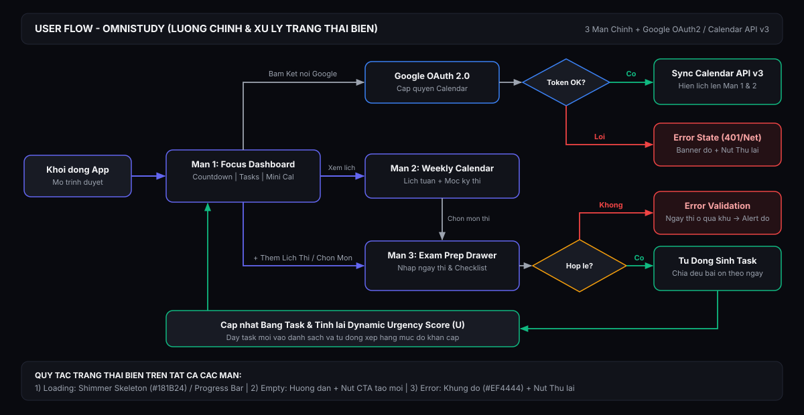
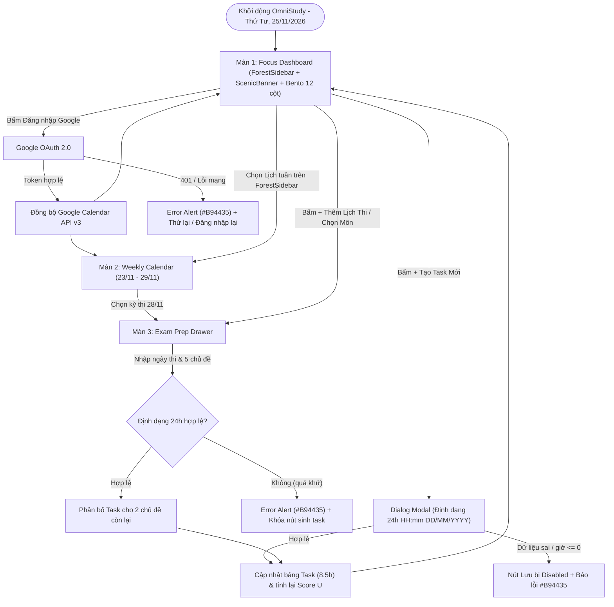

# Đặc Tả Wireframe & User Flow - OmniStudy

Tài liệu này mô tả chi tiết luồng người dùng (User Flow) và cấu trúc giao diện khung xương (Wireframe) cho **3 màn hình chính** và **2 hộp thoại nhập liệu (Dialog Modals)** của ứng dụng **OmniStudy** theo phong cách **Light-First Cozy Woodland Bento**, đồng thời đặc tả đầy đủ 3 trạng thái biên bắt buộc (**Đang tải**, **Rỗng**, **Lỗi**) phục vụ nghiệm thu Buổi 1.

---

## 1. Quy Chuẩn Bố Cục, Dữ Liệu Nhất Quán & Chuyển Động

Toàn bộ bản vẽ Wireframe dưới đây tuân thủ bộ quy chuẩn **Cozy Woodland Bento** và 7 tiêu chuẩn nhất quán dữ liệu:

1. **Khung ứng dụng (Application Shell):**
   - **Left `ForestSidebar` (`248px`):** Nền `#2F4231` (hover `#3B513D`), biển tiêu đề gỗ `#9B6B43` (viền `#7A5130`, chữ `#FDF9F0`), chữ điều hướng `#F4EFE2` / `#C6D1BF` cho 4 tuyến trang (`Tổng quan`, `Lịch tuần`, `Lịch thi`, `Đăng nhập Google`) và thẻ ghi chú học tập `#4A5F44`.
   - **`ScenicHeaderBanner`:** Bức họa rừng thông và mặt hồ tĩnh lặng tối giản (không nhân vật game), hiển thị lời chào cá nhân, mốc ngày thực tế **`Thứ Tư, 25/11/2026`**, mùa/đồng hồ thời gian thực, Avatar và nút hành động `+ Thêm Lịch Thi` (`#4F7043`).
   - **Lưới Bento 12 cột (`BentoLayout`):** Nền Canvas Warm Parchment `#ECE7D8`, các thẻ Bento nền Warm Cream `#FAF6EC` bo góc `16px` (`rounded-2xl`) và viền mảnh `1px solid #DDD6C3`; các thẻ con và ô nhập liệu dùng nền Soft Oat `#F1ECDD` bo góc `12px` (`rounded-xl`).
2. **Mốc thời gian tháng 11/2026 chính xác:**
   - Hôm nay: **`Thứ Tư, 25/11/2026`**.
   - Lịch tuần hiện tại: **`Thứ 2 (23/11)`** đến **`CN (29/11)`**, làm nổi bật cột **`Thứ 4 (25/11)`**.
   - Kỳ thi sắp tới: **`08:30 - Thứ Bảy, 28/11/2026`** (Phòng 402 - Giảng đường A2).
3. **Số liệu nhất quán và `tabular-nums`:**
   - Mọi con số (đồng hồ đếm ngược, điểm khẩn cấp $U$, tỷ lệ sẵn sàng `%`, số giờ, số lượng công việc) đều bắt buộc dùng `'JetBrains Mono'` kèm `font-variant-numeric: tabular-nums`.
   - Đồng hồ đếm ngược hiển thị trên **1 hàng ngang duy nhất** gồm 4 ô cân bằng (`03 Ngày | 14 Giờ | 22 Phút | 45 Giây`), không xuống dòng chữ `Giây`.
   - Thống kê giờ dự kiến trong ngày là **`8.5h`**, khớp chính xác tổng của 4 công việc đang mở (`1.5h + 2.0h + 3.0h + 2.0h = 8.5h`).
   - Tỷ lệ sẵn sàng kỳ thi là **`60% (3/5 chủ đề)`** với đúng 3 chủ đề đã hoàn thành và 2 chủ đề còn lại.
4. **Quy tắc chuyển động (Motion & Accessibility):**
   - `PageTransitionWrapper`: cross-fade kết hợp trượt dọc nhẹ (`280ms cubic-bezier(0.22, 1, 0.36, 1)`).
   - `ExamPrepDrawer`: trượt ngang từ cạnh phải (`360ms cubic-bezier(0.16, 1, 0.3, 1)`).
   - Danh sách Task xuất hiện tuần tự (`35ms/step`, tối đa `210ms`); hover thẻ nâng `-2px`; hỗ trợ đầy đủ `@media (prefers-reduced-motion: reduce)`.

---

## 2. Sơ Đồ Luồng Người Dùng (User Flow)





---

## 3. Đặc Tả Wireframe 3 Màn Hình Chính & Modals

### Màn Hình 1: Focus Dashboard (Cozy Woodland Bento Grid)


#### Bố cục Wireframe tổng thể (Desktop - `12` cột trong vùng nội dung chính):
```text
+------------------------+-----------------------------------------------------------------------------------+
| FOREST SIDEBAR (248px) | SCENIC WOODLAND HEADER BANNER (Rừng thông & hồ yên tĩnh)                         |
| Nền: #2F4231           | Chào buổi tối, Khánh | Thứ Tư, 25/11/2026 | Mùa Thu     [+ Thêm Lịch Thi] [K]  |
| +--------------------+ +-----------------------------------------------------------------------------------+
| | [OMNISTUDY] #9B6B43| | HÀNG 1 - BENTO GRID (5 Cột + 7 Cột)                                               |
| +--------------------+ | +---------------------------------------+ +---------------------------------------+ |
| > Tổng quan (#4A5F44)  | | KHỐI 1: EXAM COUNTDOWN (5 Cột)        | | KHỐI 2: DAILY STATS OVERVIEW (7 Cột)  | |
|   Lịch tuần            | | CTDL & Giải thuật                     | | - Active hôm nay: 04 task             | |
|   Lịch thi             | | 08:30 - Thứ Bảy, 28/11/2026 (P.402)   | | - Đã xong: 02/06 task (33%)           | |
|   Google Sync          | |                                       | | - Tổng giờ dự kiến: 8.5h              | |
|                        | | [03 Ngày][14 Giờ][22 Phút][45 Giây]   | |   (1.5h + 2.0h + 3.0h + 2.0h = 8.5h)  | |
| +--------------------+ | | (1 hàng ngang duy nhất, tabular-nums) | | [=========== 33% ===================] | |
| | Study Tip (#4A5F44)| | | Sẵn sàng: 60% [========     ] (3/5)   | | [+ Tạo Task Mới]  [Mở Exam Drawer]    | |
| | Ưu tiên việc gấp   | | +---------------------------------------+ +---------------------------------------+ |
| | trước 23:59        | | HÀNG 2 - BENTO GRID (8 Cột + 4 Cột)                                               |
| +--------------------+ | +---------------------------------------------------+ +---------------------------+ |
|                        | | KHỐI 3: URGENCY TASK BOARD (8 Cột)                | | KHỐI 4: MINI SCHEDULE     | |
|                        | | (Viền 1px + chấm trạng thái + pill, tổng 8.5h)    | | (Google Calendar - 4 Cột) | |
|                        | |                                                   | |                           | |
|                        | | (o) [ ] Hoàn thành báo cáo Đồ án Web              | | 09:00 - 11:30             | |
|                        | |     Còn 2.5h | Ước tính: 1.5h | P4   [EXTREME 89.0]| | Họp nhóm đồ án (G-Cal)    | |
|                        | |                                                   | |                           | |
|                        | | (o) [ ] Ôn tập Đồ thị & Duyệt BFS/DFS             | | 14:00 - 16:00             | |
|                        | |     Còn 6.0h | Ước tính: 2.0h | P3   [HIGH 65.0]   | | Học Ca 2 trên trường      | |
|                        | |                                                   | |                           | |
|                        | | (o) [ ] Ôn Cây khung nhỏ nhất Prim/Kruskal        | | 19:30 - 21:00             | |
|                        | |     Còn 15.0h | Ước tính: 3.0h | P2  [MOD 43.0]    | | Tự học ở thư viện         | |
|                        | |                                                   | |                           | |
|                        | | (o) [ ] Đọc tài liệu Mạng máy tính Chương 4     | |                           | |
|                        | |     Còn 30.0h | Ước tính: 2.0h | P1  [LOW 21.0]    | |                           | |
|                        | +---------------------------------------------------+ +---------------------------+ |
+------------------------+-----------------------------------------------------------------------------------+
```

#### 3 Trạng thái của Màn 1:
1. **Trạng thái Đang tải (Loading State):**
   - Khối Exam Countdown, Daily Stats, Urgency Task Board (4 hàng skeleton) và Mini Schedule hiển thị **Warm-Cream Shimmer Skeleton** sử dụng hiệu ứng `@keyframes warmShimmer` quét ngang qua 2 tông `#F1ECDD` và `#FAF6EC` (bo góc `12px`).
   - Tuyệt đối không dùng full-screen spinner và giữ đúng chiều cao thẻ thật để triệt tiêu Layout Shift.
2. **Trạng thái Rỗng (Empty State):**
   - Khi chưa có công việc: Bảng task hiển thị họa tiết lá cây tối giản nét `1.75px` màu `#4F7043`, dòng chữ *"Chưa có công việc nào cần hoàn thành"* và nút hành động chính `+ Tạo Công Việc Đầu Tiên` (`#4F7043`).
   - Khi chưa có kỳ thi: Khối Exam Countdown hiển thị *"Chưa có kỳ thi nào được lên lịch"* và nút `+ Thêm Môn Thi`.
3. **Trạng thái Lỗi (Error State):**
   - Khi mất kết nối hoặc hết hạn token Google Calendar (`401`): Khối Mini Schedule hiển thị khung nền `#FBEAE7`, viền mảnh `1px solid #B94435`, chữ `#9A3326` kèm nút `Đăng nhập lại Google` và `Thử lại`.

---

### Màn Hình 2: Lịch Biểu Tuần & Lịch Thi (Weekly Calendar & Exam Timeline)


#### Bố cục Wireframe tổng thể (`Thứ 2, 23/11` đến `CN, 29/11/2026`):
```text
+------------------------+-----------------------------------------------------------------------------------+
| FOREST SIDEBAR (248px) | [< Tuần Này >]  Tháng 11, 2026 (23/11 - 29/11)     [Tất cả] [Chỉ lịch thi] [G-Cal] |
|                        +-----------+-----------+-----------+-----------+-----------+-----------+-----------+
| > Lịch tuần            | Khung giờ | T2 (23/11)| T3 (24/11)|*T4 (25/11)| T5 (26/11)| T6 (27/11)| T7 (28/11)| CN (29/11)|
|   (Active #4A5F44)     +-----------+-----------+-----------+-----------+-----------+-----------+-----------+-----------+
|                        | ALL-DAY   |           |           | Hôm nay   |           |           |[THI CTDL] |           |
|                        +-----------+-----------+-----------+-----------+-----------+-----------+-----------+-----------+
|                        | 08:00     |           |           |           |           |           | [Thi thật]|           |
|                        | 09:00     | [G-Cal]   |           | [G-Cal]   |           |           | 08:30-10:00           |
|                        |           | LT Web    |           | Họp nhóm  |           |           | Phòng 402 |           |
|                        +-----------+-----------+-----------+-----------+-----------+-----------+-----------+-----------+
|                        | 14:00     |           | [Đã ôn]   | [G-Cal]   | [Task Ôn] | [Task Ôn] |           |           |
|                        |           |           | Cây AVL   | Học Ca 2  | Đồ thị 2h | Prim 3h   |           |           |
|                        +-----------+-----------+-----------+-----------+-----------+-----------+-----------+-----------+
```

#### 3 Trạng thái của Màn 2:
1. **Trạng thái Đang tải (Loading):** Thanh tiến trình vô tận (`Indeterminate Progress Bar` màu `#4F7043` trên rãnh `#F1ECDD`) ở đỉnh lưới lịch, kết hợp các khối sự kiện dùng `@keyframes warmShimmer` trên nền lưới lịch mờ (`opacity: 0.45`).
2. **Trạng thái Rỗng (Empty):** Khi tuần được chọn không có lịch học hay lịch thi: Hiển thị thẻ trung tâm `#FAF6EC` viền `#DDD6C3` với thông báo *"Tuần này trống lịch học và lịch thi"* và nút `+ Thêm Lịch Thi / Task` (`#4F7043`).
3. **Trạng thái Lỗi (Error):** Hiển thị thanh Alert nền `#FBEAE7` viền `1px solid #B94435` ở đỉnh bảng lịch thông báo mã lỗi (`503 / Network Timeout`) kèm nút `Tải lại trang`.

---

### Màn Hình 3: Chi Tiết Môn Thi & Bộ Sinh Lộ Trình (Exam Prep Drawer)


#### Bố cục Wireframe (Slide-over Panel từ bên phải, `360ms cubic-bezier(0.16, 1, 0.3, 1)`):
```text
+-------------------------------------------------------------------+
| CHI TIẾT MÔN THI                                              [X] |
+-------------------------------------------------------------------+
| Tên môn: Cấu trúc dữ liệu & Giải thuật                            |
| Thời gian: 08:30 - Thứ Bảy, 28/11/2026                            |
| Phòng thi: 402 - Giảng đường A2  |  Trọng số điểm: 60%            |
|                                                                   |
| ĐẾM NGƯỢC (1 DÒNG, tabular-nums):                                 |
| [ 03 Ngày ] [ 14 Giờ ] [ 22 Phút ] [ 45 Giây ]                    |
| Tiến độ sẵn sàng: [==============          ] 60% (3/5 chủ đề)     |
+-------------------------------------------------------------------+
| BỘ TỰ ĐỘNG PHÂN BỔ TASK ÔN TẬP                                    |
| Khoảng cách: 3 ngày trước thi | Còn lại: 2 chủ đề chưa hoàn thành |
| [ Nút CTA (#4F7043): Tự Động Phân Bổ Task Ôn Vào Lịch ]           |
+-------------------------------------------------------------------+
| DANH SÁCH 5 CHỦ ĐỀ CẦN ÔN (CHECKLIST):                            |
| [x] 1. Cây nhị phân tìm kiếm          (Hoàn thành ngày 23/11)     |
| [x] 2. Cân bằng cây AVL               (Hoàn thành ngày 24/11)     |
| [x] 3. Bảng băm & Hashing             (Hoàn thành ngày 25/11)     |
| [ ] 4. Đồ thị & Duyệt BFS/DFS         (Dự kiến ngày 26/11)        |
| [ ] 5. Cây khung nhỏ nhất Prim/Kruskal(Dự kiến ngày 27/11)        |
|                                                                   |
| [+ Thêm chủ đề mới (Nhấn Enter)...]                               |
+-------------------------------------------------------------------+
```

#### 3 Trạng thái của Màn 3:
1. **Trạng thái Đang tải (Loading):** Hiển thị 3 hàng skeleton cho thông tin môn thi, 1 nút skeleton và 5 hàng checkbox skeleton chạy hiệu ứng `@keyframes warmShimmer`.
2. **Trạng thái Rỗng (Empty):** Khi môn thi mới chưa có chủ đề: Nút `Tự Động Phân Bổ Task` ở trạng thái `disabled` (nền `#EAE6D9`, chữ `#626F5F`), hiển thị ô nhập liệu viền focus `#4F7043`: *"Nhập tên chương hoặc bài học đầu tiên rồi nhấn Enter"*.
3. **Trạng thái Lỗi (Error):** Khi ngày thi ở quá khứ (ví dụ `08:30 20/11/2026`) hoặc dữ liệu không hợp lệ: Nút hành động bị khóa (`disabled`), ô ngày thi chuyển viền `#B94435` và hiển thị Error Alert `#FBEAE7` chữ `#9A3326` ngay bên dưới.

---

### Đặc Tả 2 Hộp Thoại Nhập Liệu (`TaskFormDialog` & `ExamFormDialog`)

Cả 2 hộp thoại tạo mới công việc (`+ Tạo Task Mới`) và tạo lịch thi (`+ Thêm Lịch Thi`) sử dụng nền `#FAF6EC`, bo góc `16px`, viền `1px solid #DDD6C3` và tuân thủ chuẩn kiểm tra dữ liệu **24 giờ**:

```text
+-------------------------------------------------------+
| TẠO CÔNG VIỆC MỚI (TaskFormDialog)                [X] |
+-------------------------------------------------------+
| Tiêu đề công việc *                                   |
| [ Ôn tập Đồ thị & Duyệt BFS/DFS                     ] |
|                                                       |
| Hạn chót (Định dạng 24h: HH:mm DD/MM/YYYY) *          |
| [ 23:59 26/11/2026                                  ] |
| (Nếu < hiện tại -> viền #B94435 + báo lỗi bên dưới)   |
|                                                       |
| Thời lượng ước tính (giờ > 0) *   | Độ ưu tiên (P1-P4)|
| [ 2.0                           ] | [ P3 - Cao      ] |
|                                                       |
| [!] Lỗi: Thời lượng ước tính phải lớn hơn 0 giờ.      |
|                                                       |
|                 [ Hủy bỏ ]   [ Lưu công việc (Disabled)]
+-------------------------------------------------------+
```

- **Định dạng thời gian bắt buộc:** Chuẩn **24 giờ (`HH:mm DD/MM/YYYY`)**, không dùng AM/PM gây nhầm lẫn hạn nộp nửa đêm (`00:00`) hay trưa (`12:00`).
- **Quy tắc khóa nút Submit (`disabled`):** Nút `Lưu công việc` / `Lưu lịch thi` tự động chuyển sang trạng thái `disabled` (nền `#EAE6D9`, chữ `#626F5F`, `cursor: not-allowed`) bất cứ khi nào tiêu đề rỗng, thời lượng $\le 0$, hoặc hạn chót / ngày thi ở quá khứ (trước `Thứ Tư, 25/11/2026`), đồng thời hiển thị thông báo lỗi màu `#9A3326` trên nền `#FBEAE7` hoặc viền `#B94435`.
