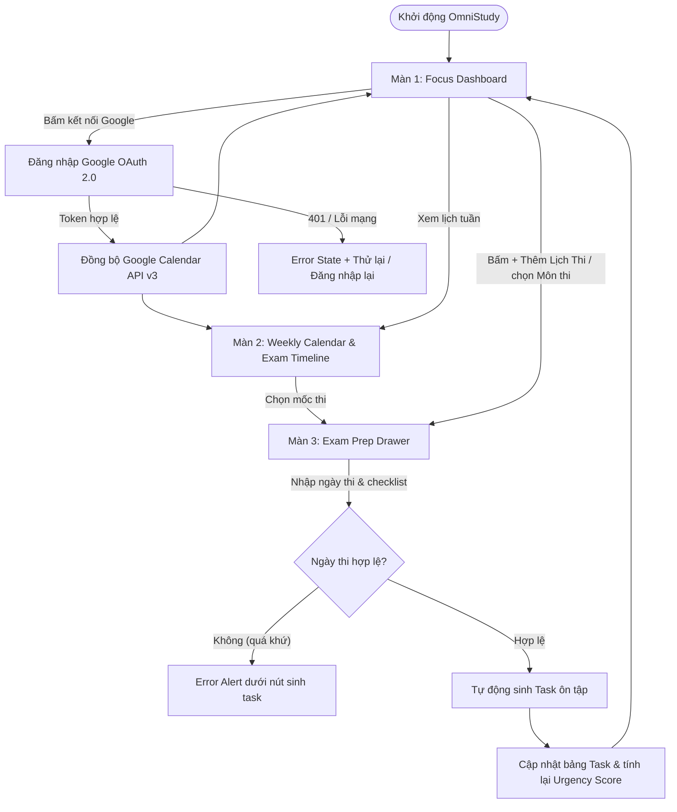
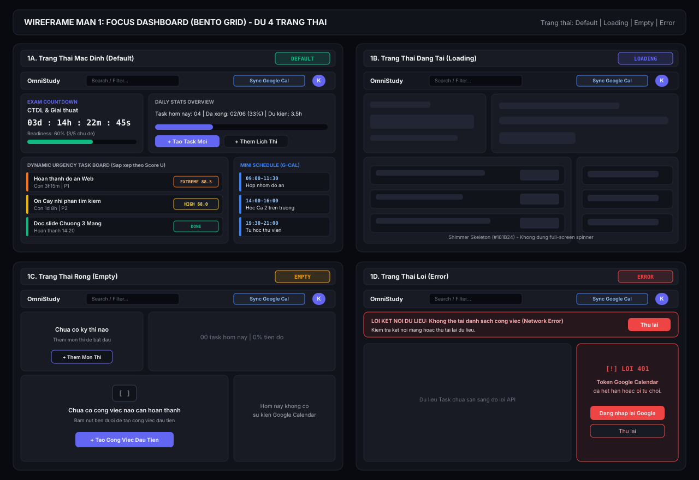
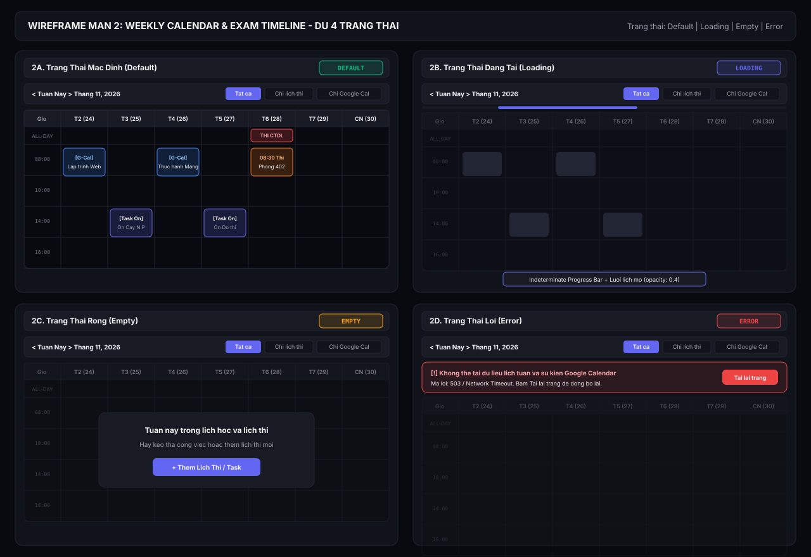
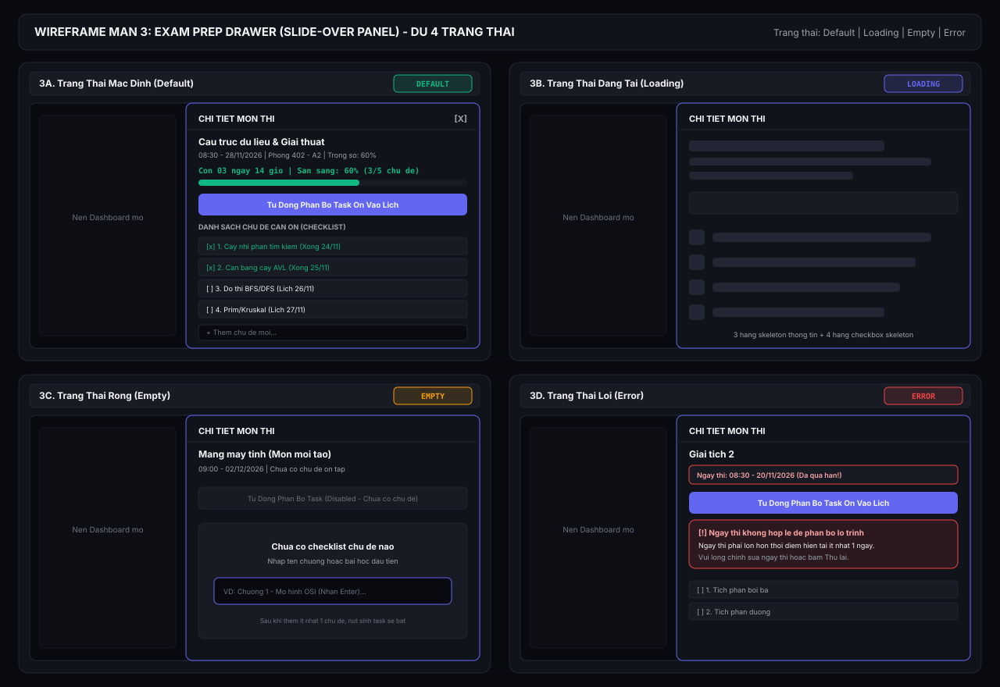

# Đặc Tả Wireframe & User Flow - OmniStudy

Tài liệu này mô tả chi tiết luồng người dùng (User Flow) và cấu trúc giao diện khung xương (Wireframe) cho **3 màn hình chính** của ứng dụng **OmniStudy**, đồng thời đặc tả chi tiết 3 trạng thái bắt buộc: **Đang tải (Loading)**, **Rỗng (Empty)** và **Lỗi (Error)** nhằm phục vụ nghiệm thu Buổi 1.

---

## 1. Sơ Đồ Luồng Người Dùng (User Flow)




---

## 2. Đặc Tả Wireframe 3 Màn Hình Chính

### Màn Hình 1: Focus Dashboard (Bento Grid)



#### Bố cục Wireframe tổng thể (Desktop):
```text
+--------------------------------------------------------------------------------------------------+
| [Logo] OmniStudy                  [Search / Filter]                 [Sync Google Calendar] [Avatar]|
+--------------------------------------------------------------------------------------------------+
| BENTO GRID (12 Cột)                                                                              |
| +-----------------------------------------------+ +----------------------------------------------+ |
| | KHỐI 1: EXAM COUNTDOWN (4 Cột)                | | KHỐI 2: DAILY STATS OVERVIEW (8 Cột)         | |
| | Môn thi sắp tới: CẤU TRÚC DỮ LIỆU & GIẢI THUẬT| | - Số task cần làm hôm nay: 04 task           | |
| | Thời gian thi: 08:30 - 28/11/2026 (Phòng 402) | | - Đã hoàn thành: 02/06 task (33%)            | |
| |                                               | | - Giờ học dự kiến: 3.5 giờ                   | |
| |  [ 03 ngày : 14 giờ : 22 phút : 45 giây ]    | | [========= 33% ==============================] | |
| |  Độ sẵn sàng: 60% [=======   ] (3/5 chủ đề)   | |                                              | |
| +-----------------------------------------------+ +----------------------------------------------+ |
| +-------------------------------------------------------------------+ +--------------------------+ |
| | KHỐI 3: DYNAMIC URGENCY TASK BOARD (8 Cột)                        | | KHỐI 4: MINI SCHEDULE    | |
| | Sắp xếp: Tự động theo hạn chót [Bộ lọc môn]    [+ Tạo Task Mới]   | | (Google Calendar - 4 Cột)| |
| |                                                                   | | Sự kiện hôm nay:         | |
| | [!] [ ] Hoàn thành đồ án Web             [EXTREME - 88.5]         | | 09:00 - 11:30            | |
| |         Còn 3 giờ 15 phút | Ước tính: 2h | P1 [Môn: Lập trình Web] | | Họp nhóm đồ án (Google)  | |
| |                                                                   | |                          | |
| | [!] [ ] Ôn tập Cây nhị phân tìm kiếm     [HIGH - 68.0]            | | 14:00 - 16:00            | |
| |         Còn 1 ngày 8 giờ  | Ước tính: 3h | P2 [Môn: CTDL&GT]       | | Học Ca 2 trên trường     | |
| |                                                                   | |                          | |
| | [ ] [x] Đọc slide Chương 3 Mạng máy tính [DONE]                   | | 19:30 - 21:00            | |
| |         Hoàn thành lúc 14:20                                      | | Tự học ở thư viện        | |
| +-------------------------------------------------------------------+ +--------------------------+ |
+--------------------------------------------------------------------------------------------------+
```

#### 3 Trạng thái của Màn 1:
1. **Trạng thái Đang tải (Loading State):**
   - Khối Exam Countdown: Hiển thị 1 khối skeleton lớn chữ nhật xám mờ `#181B24` kèm dải sáng lướt qua (`animate-pulse`).
   - Khối Task Board: Hiển thị 4 dòng skeleton mô phỏng thẻ task với độ dài ngẫu nhiên.
   - Không xuất hiện hiệu ứng nhảy khung hình khi dữ liệu thực tải xong.
2. **Trạng thái Rỗng (Empty State):**
   - Khi chưa có task nào: Bảng task hiển thị hình minh họa `CheckCircle2` mờ, dòng chữ *"Chưa có công việc nào cần hoàn thành"* và nút nổi bật `+ Tạo Công Việc Đầu Tiên`.
   - Khi chưa có môn thi nào: Khối Exam hiển thị: *"Chưa có kỳ thi nào được lên lịch. Bấm để thêm môn thi và nhận lộ trình ôn tập"*.
3. **Trạng thái Lỗi (Error State):**
   - Khi lỗi kết nối Google Calendar: Khối Mini Schedule hiển thị khung viền đỏ `1px solid #EF4444`, icon cảnh báo kèm thông báo: *"Không thể tải sự kiện Google Calendar. [Bấm để thử lại]"*.

---

### Màn Hình 2: Lịch Biểu Tuần & Lịch Thi (Weekly Calendar & Exam Timeline)



#### Bố cục Wireframe tổng thể:
```text
+--------------------------------------------------------------------------------------------------+
| [< Tuần Này >]  Tháng 11, 2026                 [Tất cả] [Chỉ lịch thi] [Chỉ Google Calendar]     |
+--------------------------------------------------------------------------------------------------+
| Khung giờ | Thứ 2 (24) | Thứ 3 (25) | Thứ 4 (26) | Thứ 5 (27) | Thứ 6 (28) | Thứ 7 (29) | CN (30) |
+-----------+------------+------------+------------+------------+------------+------------+---------+
| ALL-DAY   |            |            |            |            | [KỲ THI]   |            |         |
| BANNERS   |            |            |            |            | CTDL & GT  |            |         |
+-----------+------------+------------+------------+------------+------------+------------+---------+
| 08:00     |            |            |            |            | [THI THẬT] |            |         |
| 09:00     | [G-Cal]    |            | [G-Cal]    |            | 08:30-10:00|            |         |
|           | Lập trình  |            | Thực hành  |            | Phòng 402  |            |         |
| 10:00     | Web        |            | Mạng       |            |            |            |         |
| ...       |            |            |            |            |            |            |         |
| 14:00     |            | [Task Ôn]  |            | [Task Ôn]  |            |            |         |
|           |            | Ôn Cây N.P |            | Ôn Đồ thị  |            |            |         |
| 16:00     |            | (2 giờ)    |            | (2.5 giờ)  |            |            |         |
+--------------------------------------------------------------------------------------------------+
```

#### 3 Trạng thái của Màn 2:
1. **Trạng thái Đang tải (Loading):** Toàn bộ khung lưới mờ nhẹ (`opacity: 0.4`), một thanh chạy tiến trình vô tận (Indeterminate Progress Bar) xuất hiện ở đỉnh trang.
2. **Trạng thái Rỗng (Empty):** Khi tuần được chọn không có bất kỳ sự kiện nào: Hiển thị dòng chữ trung tâm *"Tuần này trống lịch học và lịch thi. Hãy kéo thả công việc vào đây để lên lịch ôn tập"*.
3. **Trạng thái Lỗi (Error):** Khi không tải được dữ liệu: Hiển thị thanh Alert đỏ ở trên đầu bảng lịch kèm nút `Tải lại trang`.

---

### Màn Hình 3: Chi Tiết Môn Thi & Bộ Sinh Lộ Trình (Exam Prep Drawer)



#### Bố cục Wireframe (Slide-over Panel mở từ bên phải):
```text
+-------------------------------------------------------------+
| CHI TIẾT MÔN THI                                        [X] |
+-------------------------------------------------------------+
| Tên môn: Cấu trúc dữ liệu & Giải thuật                      |
| Thời gian: 08:30 - Thứ Sáu, 28/11/2026                      |
| Phòng thi: 402 - Giảng đường A2                             |
| Trọng số điểm: 60% điểm tổng kết                            |
|                                                             |
| ĐỒNG HỒ ĐẾM NGƯỢC: Còn 03 ngày 14 giờ                       |
| Tiến độ sẵn sàng: [==============       ] 60% (3/5 chủ đề)  |
+-------------------------------------------------------------+
| BỘ CÔNG CỤ TỰ ĐỘNG SINH TASK ÔN TẬP                         |
| Khoảng cách: 3 ngày trước thi | Cần ôn: 2 chủ đề còn lại    |
| [ Nút: Tự Động Phân Bổ Task Ôn Vào Lịch ]                   |
+-------------------------------------------------------------+
| DANH SÁCH CHỦ ĐỀ CẦN ÔN (CHECKLIST):                        |
| [x] 1. Cây nhị phân tìm kiếm (Đã tạo task: Xong ngày 24/11) |
| [x] 2. Cân bằng cây AVL      (Đã tạo task: Xong ngày 25/11) |
| [ ] 3. Đồ thị & Duyệt BFS/DFS (Đã lên lịch ngày 26/11)      |
| [ ] 4. Cây khung nhỏ nhất Prim/Kruskal (Đã lên lịch 27/11)  |
|                                                             |
| [+ Thêm chủ đề mới...]                                      |
+-------------------------------------------------------------+
```

#### 3 Trạng thái của Màn 3:
1. **Trạng thái Đang tải (Loading):** Hiển thị 3 hàng skeleton cho phần thông tin chung và 4 hàng checkbox skeleton.
2. **Trạng thái Rỗng (Empty):** Khi môn thi mới tạo chưa có checklist: Hiển thị ô nhập liệu lớn *"Nhập tên chương hoặc bài học đầu tiên cần ôn tập rồi nhấn Enter"*.
3. **Trạng thái Lỗi (Error):** Khi bấm nút sinh task nhưng ngày thi đã ở quá khứ hoặc khoảng cách ngày không hợp lệ: Hiện thông báo lỗi màu đỏ ngay dưới nút *"Ngày thi không hợp lệ để phân bổ lộ trình"*.
